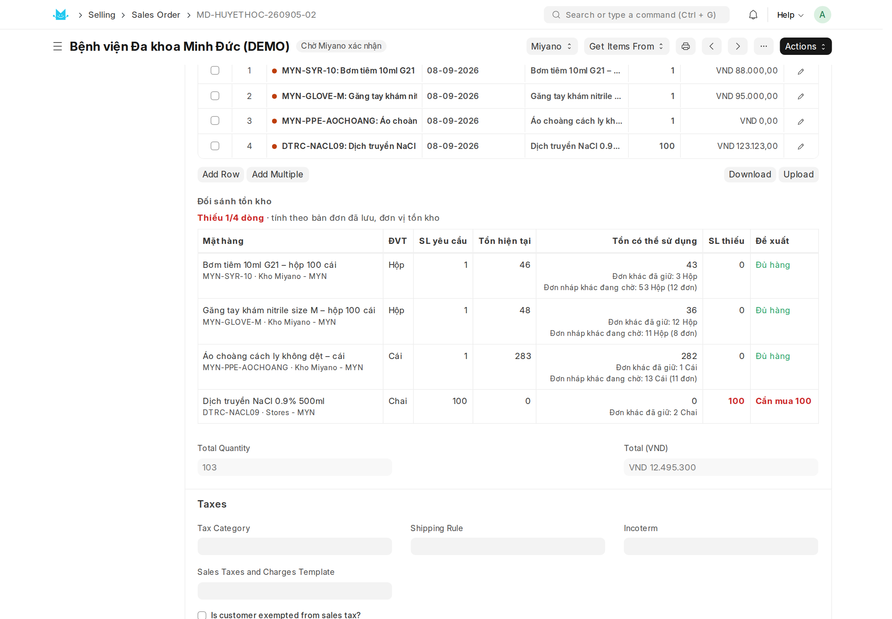
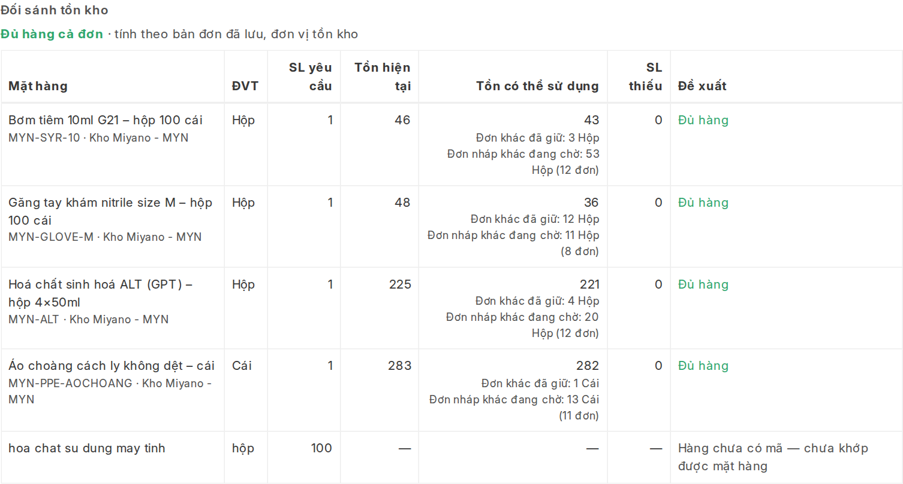
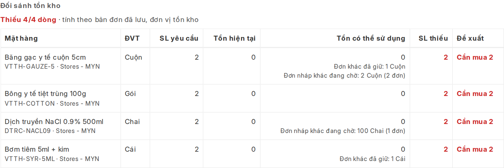
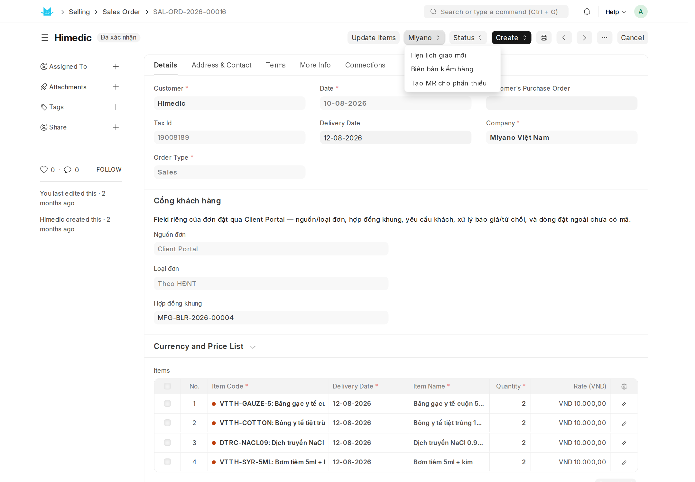
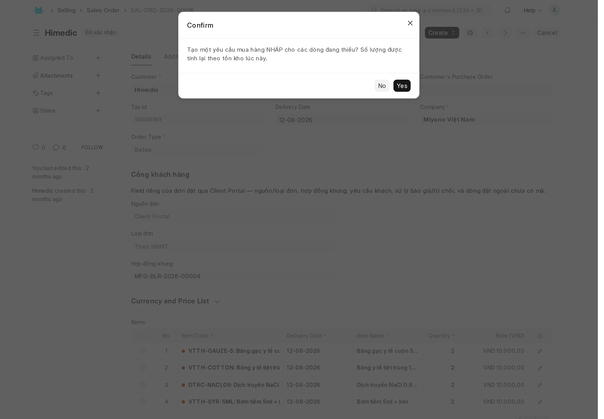
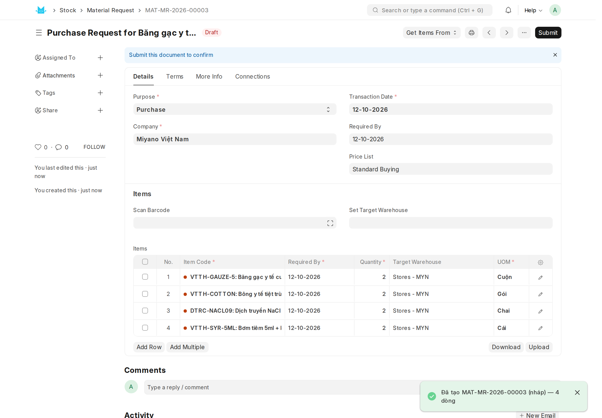
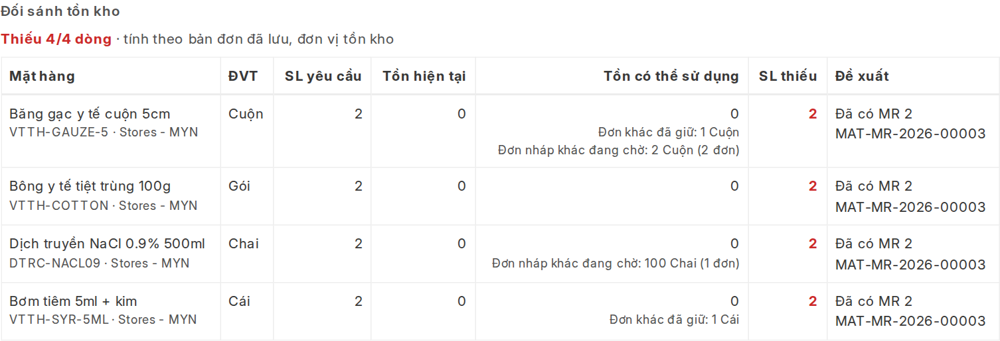

# Hướng dẫn thao tác — Đối sánh tồn kho trên Sales Order và tạo yêu cầu mua hàng

App `miyano_portal` · Cập nhật **12/10/2026**

**Tài liệu này dành cho nhân viên Miyano** thao tác trên ERP (Desk): kinh
doanh, kho và mua hàng. Nó trả lời bốn câu hỏi: bảng đối sánh nằm ở đâu, đọc
từng cột thế nào, khi thiếu hàng thì tạo yêu cầu mua hàng ra sao, và những
trường hợp nào bảng không trả lời được.

Khách hàng trên cổng **không** nhìn thấy bảng này và không thấy số tồn kho
của Miyano.

---

## 0. Chức năng làm gì

Khi đơn của khách vào ERP thành Sales Order, người xác nhận đơn phải biết:
*kho Miyano có đủ hàng cho đơn này không, thiếu bao nhiêu?*

Trước đây phải mở báo cáo tồn từng mặt hàng rồi tự trừ phần đã hứa cho đơn
khác. Nay ERP tính sẵn và hiện ngay trên đơn, kèm một nút tạo **yêu cầu mua
hàng (Material Request) nháp** cho đúng phần thiếu.

---

## 1. Bảng nằm ở đâu

Mở một Sales Order, ở tab **Details**, kéo xuống lưới **Items**. Bảng **Đối
sánh tồn kho** nằm ngay dưới lưới mặt hàng.

- Bảng có từ lúc đơn còn **nháp** cho tới khi giao xong.
- Bảng tính theo **bản đơn đã lưu**. Vừa sửa số lượng hay thêm dòng thì bấm
  **Save** để bảng tính lại.
- Dòng đầu bảng là kết luận cho cả đơn: **Đủ hàng cả đơn** (xanh) hoặc
  **Thiếu k/n dòng** (đỏ).
- Chỉ tài khoản có một trong các vai sau mới thấy bảng: Sales User, Sales
  Manager, Stock User, Stock Manager, Purchase User, Purchase Manager, System
  Manager.

---

## 2. Đọc từng cột

Mọi số lượng trong bảng tính theo **đơn vị tồn kho** của mặt hàng (cột ĐVT),
kể cả khi đơn bán theo đơn vị khác. Ví dụ đơn đặt 2 Thùng, mỗi thùng 10 Hộp
thì SL yêu cầu là 20 Hộp.

| Cột | Ý nghĩa |
|---|---|
| **Mặt hàng** | Tên hàng; dòng nhỏ bên dưới là mã hàng và **kho** của dòng đơn |
| **SL yêu cầu** | Số lượng còn phải giao. Đơn đã giao một phần thì chỉ tính phần chưa giao |
| **Tồn hiện tại** | Số hàng đang có trong kho của dòng đơn |
| **Tồn có thể sử dụng** | Tồn hiện tại, trừ lô đã hết hạn, trừ phần đã giữ cho các đơn đã xác nhận khác |
| **SL thiếu** | SL yêu cầu trừ tồn có thể sử dụng |
| **Đề xuất** | Việc cần làm với dòng này (xem bảng dưới) |

Cột **Đề xuất** có bốn giá trị:

| Hiện | Nghĩa |
|---|---|
| **Đủ hàng** | Lập phiếu giao như bình thường |
| **Cần mua n** | Thiếu n, chưa có yêu cầu mua hàng nào |
| **Đã có MR a · cần mua thêm b** | Đã có yêu cầu mua cho a, vẫn còn thiếu b |
| **Đã có MR n** | Phần thiếu đã có yêu cầu mua; mã yêu cầu ở ngay dưới, bấm để mở |

**Tồn tra theo đúng kho ghi trên dòng đơn.** Hàng nằm ở kho khác của Miyano
không được cộng vào. Muốn dùng hàng ở kho khác thì đổi kho trên dòng đơn rồi
lưu lại.

**Hai dòng cùng mặt hàng trong một đơn** dùng chung một lượng tồn: dòng trên
lấy trước, dòng dưới chỉ thấy phần còn lại.

---

## 3. Hai ghi chú nhỏ dưới ô "Tồn có thể sử dụng"

**Đơn khác đã giữ: n** — các đơn **đã xác nhận** khác đang chờ giao cùng mặt
hàng, cùng kho. Số này **đã bị trừ** khỏi tồn có thể sử dụng.

**Đơn nháp khác đang chờ: n (k đơn)** — các đơn **còn nháp** cùng mặt hàng,
cùng kho. Số này **chưa bị trừ**: đơn nháp chưa giữ hàng. Ghi chú để biết còn
ai đang chờ cùng lượng hàng đó.

> **Lưu ý khi hai đơn đã xác nhận cùng thiếu một mặt hàng.** Mỗi đơn trừ trọn
> phần của đơn kia nên cả hai đều báo thiếu. Ví dụ tồn 10, đơn A cần 7, đơn B
> cần 7: mỗi đơn thấy thiếu 4, trong khi tổng thiếu thật chỉ là 4. Thấy ghi
> chú "Đơn khác đã giữ" thì kiểm tra đơn kia đã có yêu cầu mua hàng chưa
> trước khi tạo thêm, để không mua thừa.

---

## 4. Khi nào bảng hiện gạch ngang "—"

Gạch ngang nghĩa là **không tra được**, khác với số 0 (hết hàng). Lý do được
ghi ở cột Đề xuất:

| Lý do | Việc cần làm |
|---|---|
| **Hàng chưa có mã — chưa khớp được mặt hàng** | Khớp mã cho dòng đặt ngoài của khách; khớp xong bảng sẽ tính |
| **Mặt hàng không quản lý tồn kho** | Không cần làm gì (dịch vụ, phí…) |
| **Dòng đơn chưa có kho** | Chọn kho cho dòng đơn rồi lưu |
| **Nhà cung cấp giao thẳng — không qua kho Miyano** | Không cần làm gì |
| **Bộ sản phẩm — tồn nằm ở các mặt hàng thành phần** | Kiểm tra tồn từng thành phần |

Các dòng gạch ngang không tính vào số "Thiếu k/n dòng" và không vào yêu cầu
mua hàng.

---

## 5. Tạo yêu cầu mua hàng cho phần thiếu

Nút chỉ có khi đơn **đã xác nhận (Submit)** và còn phần thiếu chưa có yêu cầu
mua. Đơn còn nháp thì bảng vẫn hiện số thiếu nhưng chưa có nút: xác nhận đơn
trước.

1. Trên đầu đơn bấm nhóm nút **Miyano** → **Tạo MR cho phần thiếu**.

2. Bấm **Yes** ở hộp xác nhận. Số lượng được tính lại theo tồn kho đúng lúc
   bấm, nên có thể khác chút ít so với bảng nếu hàng vừa nhập hoặc vừa xuất.

3. ERP mở yêu cầu mua hàng vừa tạo. Yêu cầu ở trạng thái **Draft**, chỉ gồm
   các dòng thiếu, đúng số thiếu, kho nhận là kho của dòng đơn.

4. Bộ phận mua hàng kiểm tra rồi bấm **Submit**. ERP không tự Submit.

**Ngày cần hàng** (Required By) lấy theo ngày giao của dòng đơn; ngày đó đã
qua thì lấy ngày hôm nay.

Quay lại đơn, cột Đề xuất đổi thành **Đã có MR n** kèm mã yêu cầu, và nút
"Tạo MR cho phần thiếu" không còn nữa.

Bấm tạo lần nữa cũng không sinh trùng: phần đã nằm trên một yêu cầu mua (nháp
hoặc đã Submit) được trừ ra. Chỉ khi thiếu thêm, ví dụ đơn khác vừa lấy mất
hàng, nút mới hiện lại và chỉ tạo cho phần thiếu thêm.

---

## 6. Báo khách ngày giao dự kiến

Đơn thiếu hàng thì sau khi tạo yêu cầu mua, hỏi nhà cung cấp ngày có hàng rồi
bấm **Miyano → Hẹn lịch giao mới** trên đơn để ghi ngày hẹn. Khách nhận thông
báo trên cổng và qua email. ERP không tự tính ngày giao.

---

## 7. Câu hỏi thường gặp

**Hàng mua về rồi mà bảng vẫn ghi "Đã có MR"?**
Bảng chỉ biết hàng đã về khi phiếu nhập kho được lập **từ Purchase Order tạo
ra từ chính yêu cầu mua đó**. Mua bằng một Purchase Order lập tay, không nối
với yêu cầu mua, thì yêu cầu vẫn bị coi là đang chờ hàng. Luôn lập Purchase
Order từ Material Request.

**Hàng về đủ thì bảng thế nào?**
Sau khi nhập kho, tồn hiện tại tăng và dòng tự chuyển sang **Đủ hàng**.

**Bấm tạo MR thì báo "Đơn có nhiều dòng thiếu của cùng một mặt hàng"?**
Đơn có hai dòng thiếu cùng mặt hàng, mà ERP đang không cho một mặt hàng xuất
hiện hai lần trên một chứng từ mua. Nhờ quản trị bật **Allow Item To Be Added
Multiple Times in a Transaction** trong Buying Settings rồi tạo lại.

**Bấm tạo MR thì báo "Bạn không có quyền tạo yêu cầu mua hàng"?**
Tài khoản chỉ có vai kinh doanh thì xem được bảng nhưng không tạo được yêu cầu
mua. Chuyển cho bộ phận kho hoặc mua hàng tạo.

**Tồn hiện tại 10 mà tồn có thể sử dụng chỉ 3?**
Xem hai ghi chú ở mục 3: phần chênh là hàng đã giữ cho đơn đã xác nhận khác,
hoặc là lô đã hết hạn.

**Lô sắp hết hạn có bị trừ không?**
Không. Chỉ lô **đã** hết hạn mới bị trừ; lô cận hạn vẫn tính là dùng được.

**Xác nhận đơn thiếu hàng có bị chặn không?**
Không. Bảng chỉ là thông tin để quyết định; ERP không chặn việc xác nhận đơn.
