# Hướng dẫn sử dụng — Giá theo Bảng giá của khách & Thời gian giao hàng

App `miyano_portal` · Cập nhật **12/10/2026**

Tài liệu này mô tả hai chức năng mới:

| Chức năng | Tóm tắt | Phần |
|---|---|---|
| **Giá theo Bảng giá (Price List) của khách** | Khách thấy mọi mặt hàng; mặt hàng có giá trong Bảng giá thì hiện giá và đặt ngay, mặt hàng chưa có giá thì vẫn chọn được và đi đường báo giá. Giá khách đồng ý được ghi luôn vào Bảng giá. | [A](#a--khách-hàng-đặt-hàng-theo-bảng-giá), [B](#b--nhân-viên-miyano-báo-giá-và-ghi-giá-vào-bảng-giá) |
| **Thời gian giao hàng** | Ngày dự kiến giao của từng mặt hàng và ngày giờ giao thật của từng đợt hiện trên cổng và trong email. | [C](#c--thời-gian-giao-hàng) |

Kèm theo: [D. Bảng tra](#d--bảng-tra) · [E. Sự cố thường gặp](#e--sự-cố-thường-gặp) ·
[F. Hệ thống cố ý KHÔNG làm](#f--hệ-thống-cố-ý-không-làm)

**Địa chỉ môi trường thử nghiệm**

- Cổng khách hàng: <http://192.168.61.129:8003/portal>
- Desk nhân viên: <http://192.168.61.129:8003/app>

> Tài liệu này **thay** các đoạn nói về giá hợp đồng, hạn mức hợp đồng và "đơn
> có hàng chờ báo giá thì CẢ ĐƠN chờ" trong
> `HDSD-hai-vai-khach-hang-va-nhan-vien.md` và `HDSD-phan-quyen-khoa-phong.md`.
> Chỗ nào hai tài liệu nói khác nhau thì theo tài liệu này. Ảnh minh hoạ chụp
> trên dữ liệu thử của khách "Bệnh viện Đa khoa Minh Đức (DEMO)".

---

## Điều gì đã đổi — đọc phần này trước

| Trước đây | Bây giờ |
|---|---|
| Khách chọn hợp đồng rồi mới thấy hàng và giá của hợp đồng đó | Khách thấy **toàn bộ danh mục**. Giá lấy từ **Bảng giá của chính khách đó** |
| Cổng chặn đặt quá hạn mức còn lại của hợp đồng | Cổng **không kiểm soát theo hợp đồng nữa**. Hợp đồng vẫn lập trên ERP; khi ghi sổ, đơn giá hợp đồng vẫn được chép vào Bảng giá của khách |
| Giỏ có một mặt hàng chưa có giá thì cả đơn chờ báo giá | Giỏ trộn **tách thành hai**: phần có giá đi ngay, phần chưa có giá đi báo giá riêng |
| Giá báo xong chỉ nằm trên đơn đó | Khách **Đồng ý** thì giá được **ghi vào Bảng giá**; lần sau khách thấy giá và đặt ngay |
| Cổng chỉ hiện ngày ghi sổ phiếu giao | Cổng hiện **ngày dự kiến giao từng mặt hàng** và **ngày giờ giao thật từng đợt** |

```
KHÁCH                                         MIYANO (Desk)
─────                                         ─────────────
Chọn hàng, giỏ có cả hàng CÓ GIÁ và CHƯA CÓ GIÁ
   │
   ├─ phần có giá ──────► đơn "Theo bảng giá" ──► Xác nhận ──► Giao hàng
   │
   └─ phần chưa có giá ─► đơn "Mua lẻ" ─────────► điền đơn giá
                                                   bấm "Gửi khách duyệt"
        ◄──────────── báo giá ─────────────────────┘
        │
        └─ Đồng ý ──► giá được GHI VÀO BẢNG GIÁ ──► Xác nhận ──► Giao hàng
                      (lần sau khách thấy giá, đặt ngay)
```

---

# A — KHÁCH HÀNG: đặt hàng theo Bảng giá

## A1. Chọn hàng — cột "Giá" cho biết mặt hàng thuộc loại nào

Vào **🛒 Đặt hàng**. Không còn bước chọn hợp đồng: danh mục hiện tất cả mặt hàng
Miyano bán cho đơn vị.

| Nhãn ở cột GIÁ | Nghĩa là | Đặt thì sao |
|---|---|---|
| **Bảng giá 35.000 ₫** (xanh) | Mặt hàng đã có giá trong Bảng giá của đơn vị | Đặt ngay theo giá đó |
| **Chờ báo giá** (cam) | Chưa có giá | Vẫn bấm **+ Giỏ** được; Miyano sẽ báo giá |

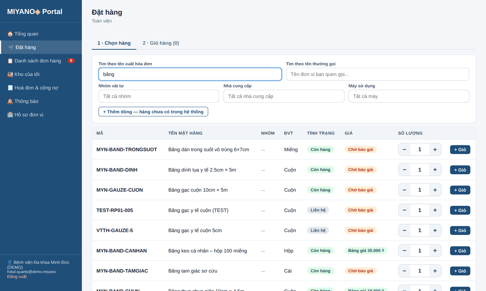

## A2. Giỏ hàng trộn — tách thành hai phiếu

Sang tab **2 · Giỏ hàng**. Mỗi dòng ghi rõ nguồn giá ngay dưới tên mặt hàng.
Khi giỏ có cả hai loại, cuối màn hình có dòng báo trước:

> Lần đặt này sẽ tách thành 2 phiếu: 1 mặt hàng đặt ngay theo bảng giá, 1 mặt
> hàng chờ Miyano báo giá.

**Tạm tính (hàng có giá)** chỉ cộng các dòng đã có giá; dòng chờ báo giá hiện
"—", không tính là 0 đồng.

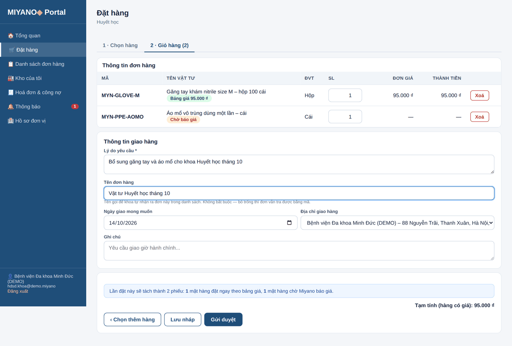

Nút cuối màn tuỳ vai của người đặt:

| Người đặt | Nút | Kết quả |
|---|---|---|
| Nhân viên khoa | **Gửi duyệt** | Hai **phiếu đề xuất** ở "Chờ duyệt", chờ quản lý đơn vị duyệt |
| Quản lý / người được đặt thẳng | **Đặt hàng** | Hai **đơn hàng** gửi thẳng tới Miyano |

Giỏ chỉ có một loại hàng thì vẫn là một phiếu như trước.

## A3. Sau khi gửi — hai phiếu đi cùng nhau

Hai phiếu mang chung một **mã lần đặt**. Trong **📋 Danh sách đơn hàng**, cạnh mã
mỗi phiếu có chữ "Lần đặt …" để nhận ra chúng là một cặp.

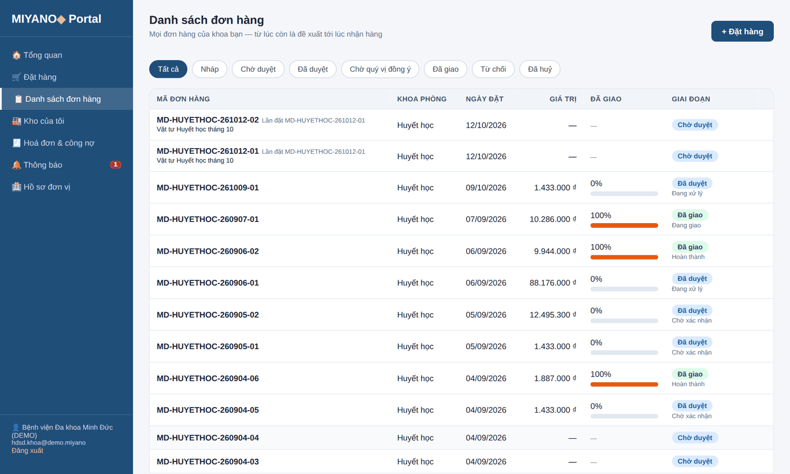

Mở một phiếu sẽ thấy dòng **Cùng lần đặt …** dẫn sang phiếu kia.

Người đặt thẳng (quản lý) thấy thông báo "Đã tạo 2 đơn: 1 đơn đặt ngay, 1 đơn
chờ báo giá."

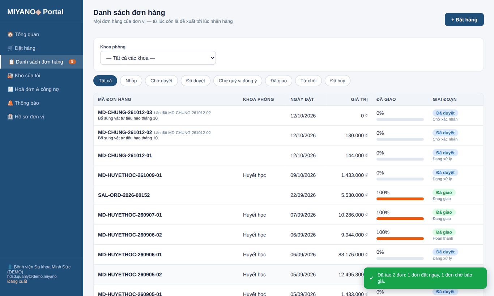

## A4. Quản lý đơn vị duyệt — "Duyệt cả hai"

Quản lý mở một trong hai phiếu. Khối **Việc đang chờ bạn** có:

| Nút | Làm gì |
|---|---|
| **Duyệt** | Duyệt riêng phiếu đang mở |
| **Duyệt cả hai** | Duyệt phiếu đang mở **và** phiếu cùng lần đặt. Hệ thống hỏi lại một lần trước khi làm. Phiếu kia được duyệt đúng số lượng khoa đề xuất; số lượng sửa trên màn này chỉ áp cho phiếu đang mở |
| **Từ chối** / **Huỷ phiếu** | Như trước, chỉ áp cho phiếu đang mở |

**Cảnh báo giá đã thay đổi.** Nếu Bảng giá đổi trong lúc phiếu chờ duyệt, khối
màu cam hiện giá cũ → giá mới. Việc này **không chặn duyệt**: đơn hàng lấy
**giá mới** tại lúc duyệt.

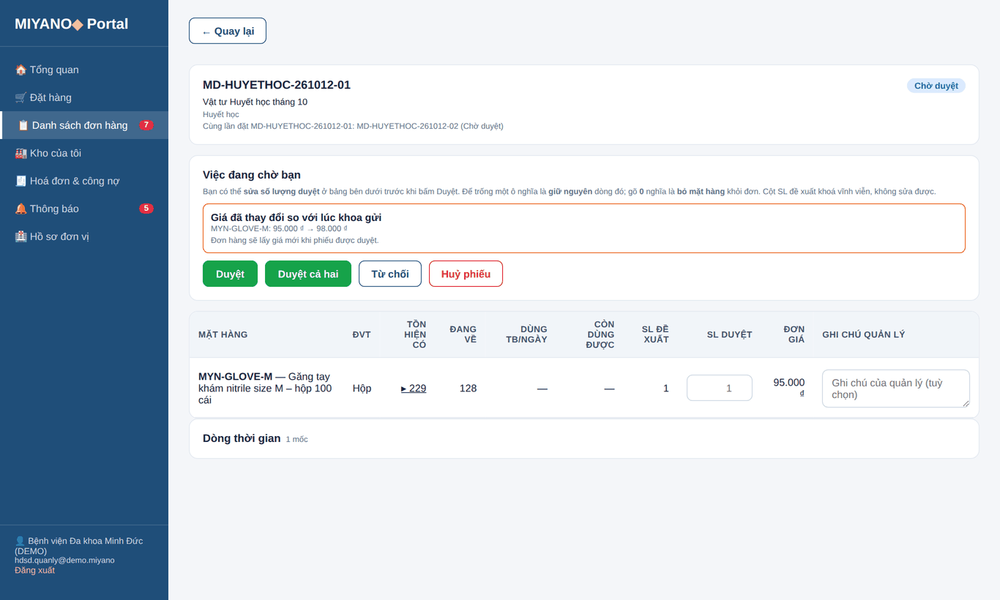

Nếu một mặt hàng **mất giá** (bị gỡ khỏi Bảng giá), hệ thống chặn duyệt và nói
rõ phải làm gì: người lập phiếu **thu hồi** phiếu rồi **gửi duyệt lại** — khi đó
mặt hàng ấy chuyển sang "Chờ báo giá".

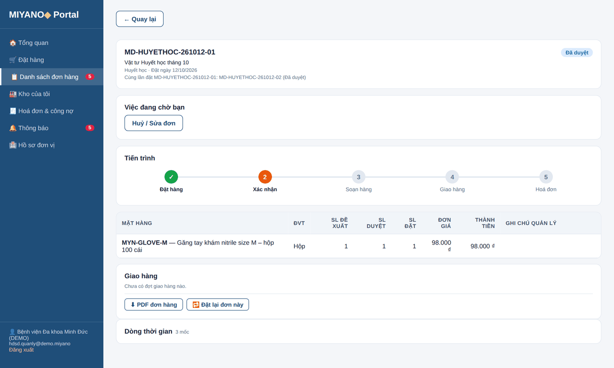

## A5. Đơn chờ báo giá trông thế nào

Dòng chưa có giá hiện **Chờ báo giá** ở cột Đơn giá và "—" ở Thành tiền (không
hiện "0 ₫").

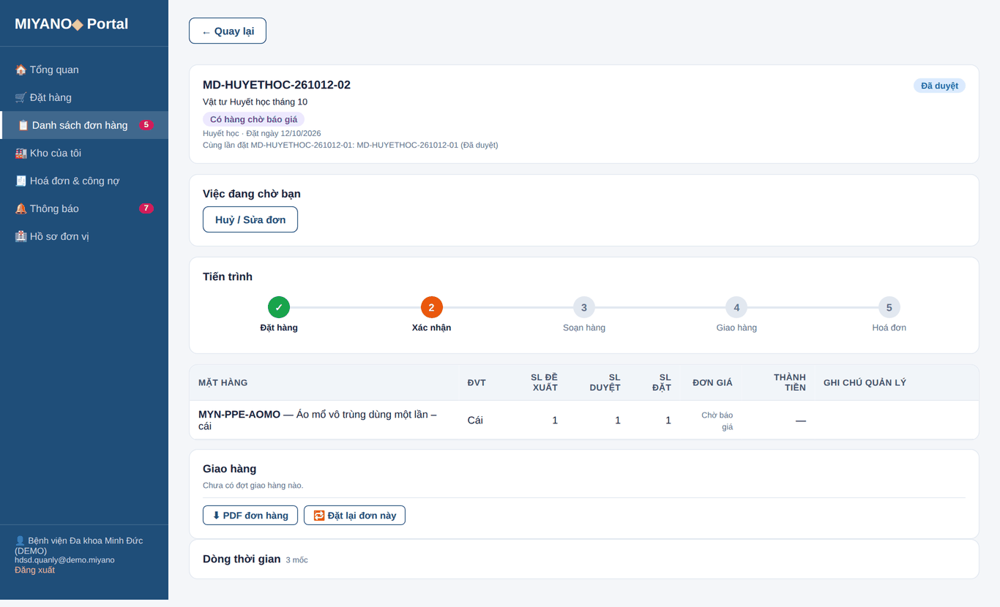

## A6. Nhận báo giá và trả lời

Khi Miyano báo giá, đơn chuyển sang **Chờ quý vị đồng ý**, đơn vị nhận thông
báo và email. Mở đơn sẽ thấy hạn hiệu lực báo giá, nút **Tải báo giá (PDF)** và
ba lựa chọn:

| Nút | Kết quả |
|---|---|
| **✔ Đồng ý đặt hàng** | Chấp nhận giá. Hệ thống ghi lại người bấm và thời điểm. Giá được ghi vào Bảng giá của đơn vị |
| **✕ Không đồng ý…** | Đơn quay về Miyano để báo giá lại |
| **Huỷ đơn…** | Huỷ đơn |

Số lượng chưa đúng thì sửa ở ô số lượng rồi bấm **Gửi lại để báo giá**: đơn về
Miyano xác nhận lại theo số lượng mới.

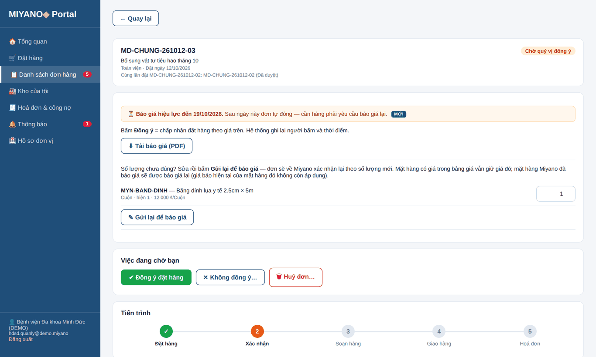

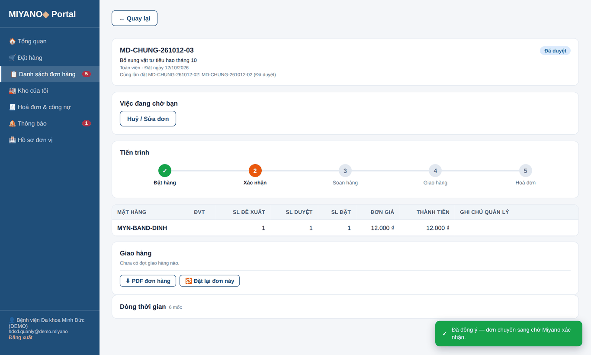

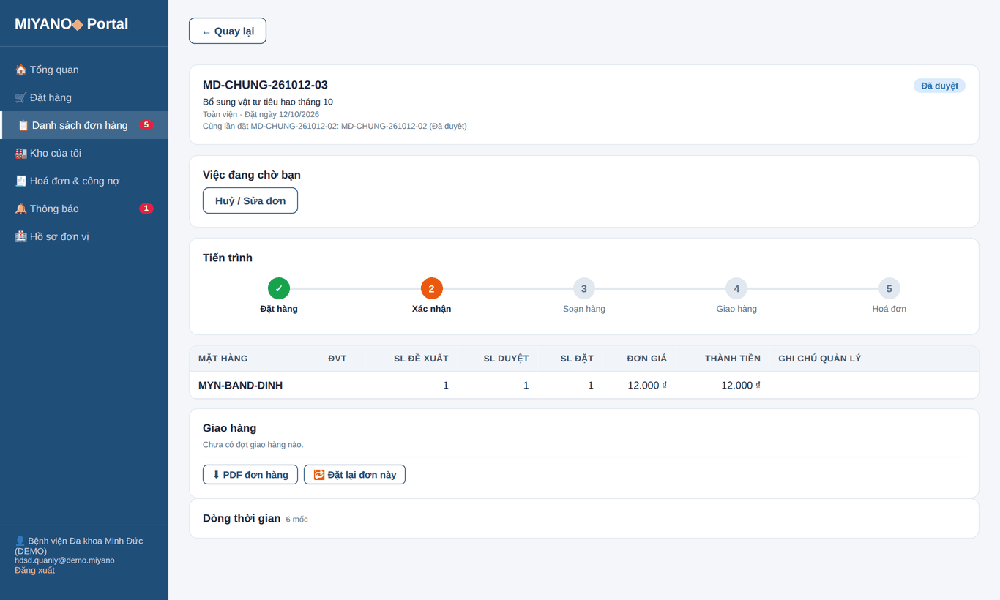

## A7. Lần sau — mặt hàng đó đã có giá

Ngay sau khi đồng ý, mặt hàng vừa được báo giá hiện **Bảng giá 12.000 ₫** trên
màn chọn hàng và đặt ngay được, không phải xin báo giá lại.

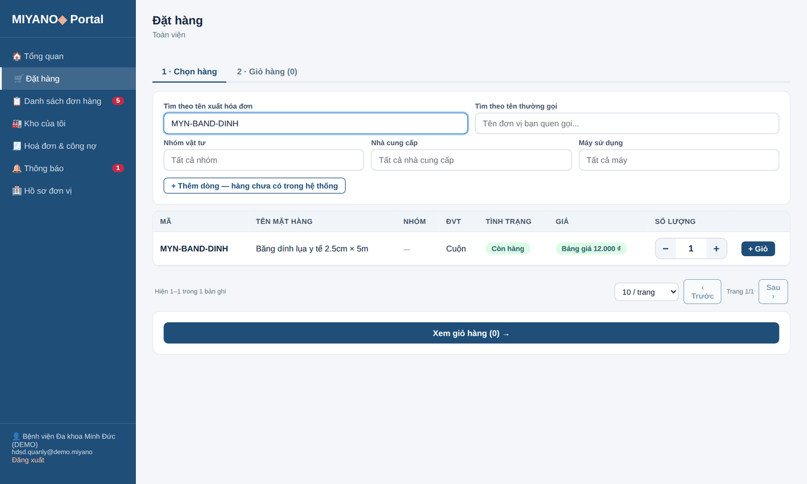

---

# B — NHÂN VIÊN MIYANO: báo giá và ghi giá vào Bảng giá

## B1. Hai loại đơn từ cổng

Mở đơn trên Desk, khối **Cổng khách hàng**, trường **Loại đơn**:

| Loại đơn | Gồm | Xử lý |
|---|---|---|
| **Theo bảng giá** | Chỉ các dòng đã có giá trong Bảng giá của khách | Kiểm tra rồi **Gửi duyệt** → **Xác nhận** như đơn thường |
| **Mua lẻ** | Các dòng chờ báo giá | Phải điền giá và **Gửi khách duyệt** trước |

Mỗi dòng hàng có trường **Nguồn giá** (`Bảng giá` hoặc `Báo giá`) và **Giá
khách đã đồng ý**. Hai trường này không nằm trên lưới; bấm biểu tượng bút chì ở
cuối dòng để xem.

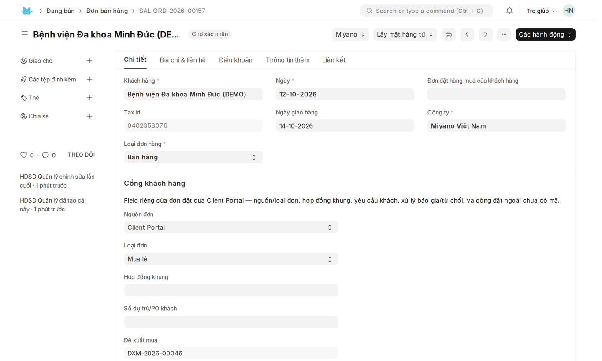

## B2. Báo giá

1. Mở đơn "Mua lẻ" đang ở **Chờ xác nhận**.
2. Trong bảng **Các mặt hàng**, điền **Đơn giá** cho từng dòng rồi **Lưu**.
3. Bấm **Các hành động → Gửi khách duyệt**. Đơn sang **Chờ khách đồng ý**; khách
   nhận thông báo và email kèm hạn hiệu lực báo giá.

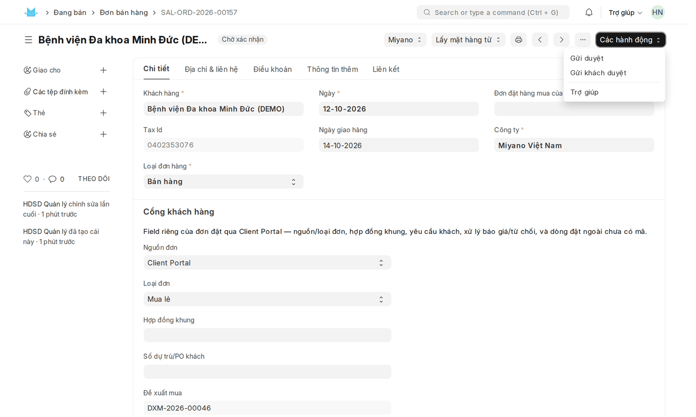

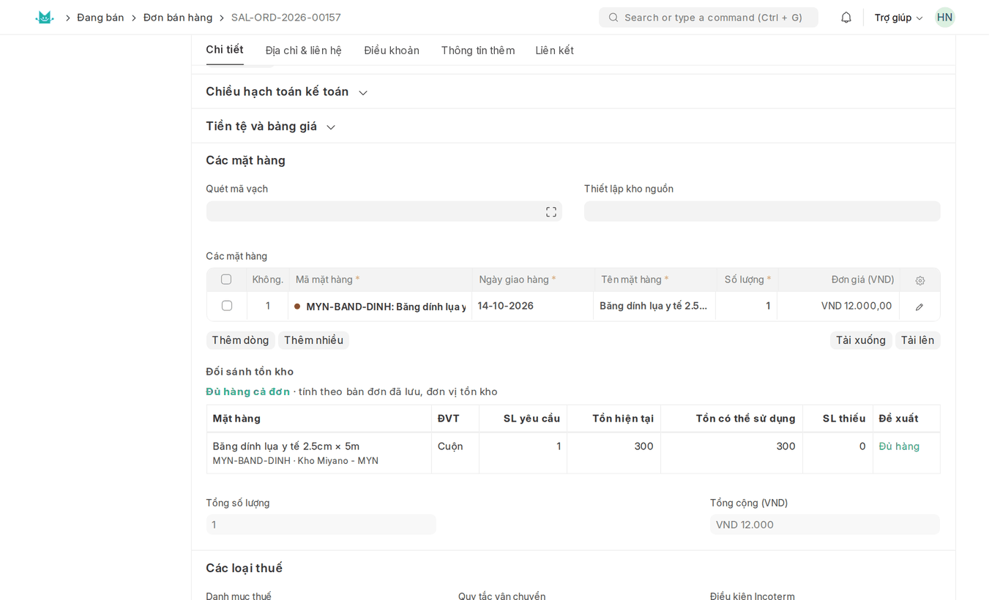

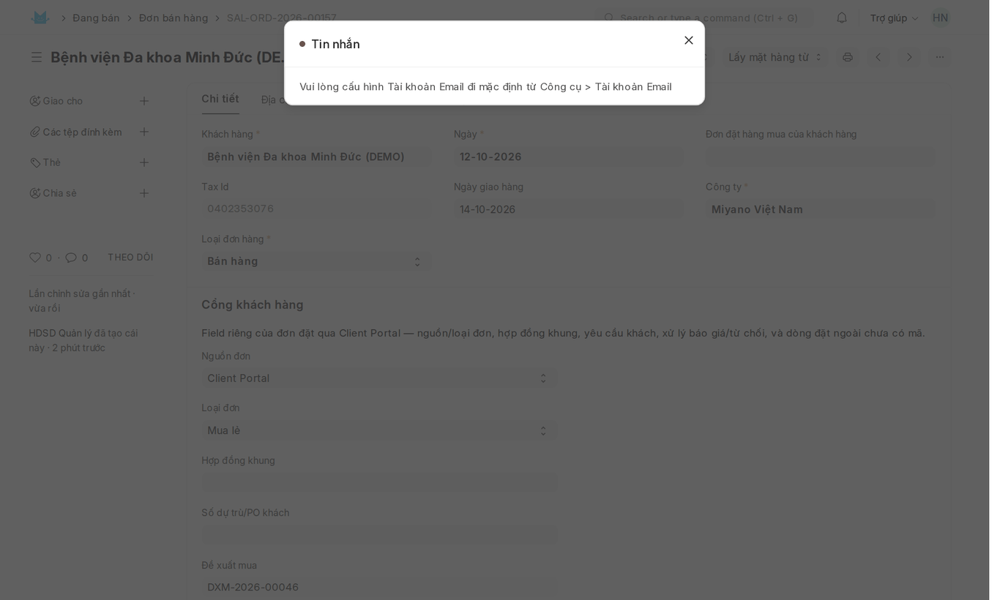

## B3. Ba chốt chặn của hệ thống

| Chốt | Khi nào chặn | Thông báo |
|---|---|---|
| 1 | Bấm **Gửi duyệt** / **Xác nhận** cho đơn còn dòng báo giá mà khách chưa đồng ý | "Đơn có hàng chờ báo giá — dùng «Gửi khách duyệt» để khách đồng ý giá trước khi Miyano xác nhận." |
| 2 | Bấm **Gửi khách duyệt** khi còn dòng chưa có đơn giá | "Chưa gửi khách được — còn mặt hàng chưa có đơn giá: …" |
| 3 | Sau khi khách đồng ý mà đơn giá trên đơn khác giá khách đã đồng ý | "Đơn giá của … khác giá khách đã đồng ý — gửi khách duyệt lại trước khi xác nhận." |

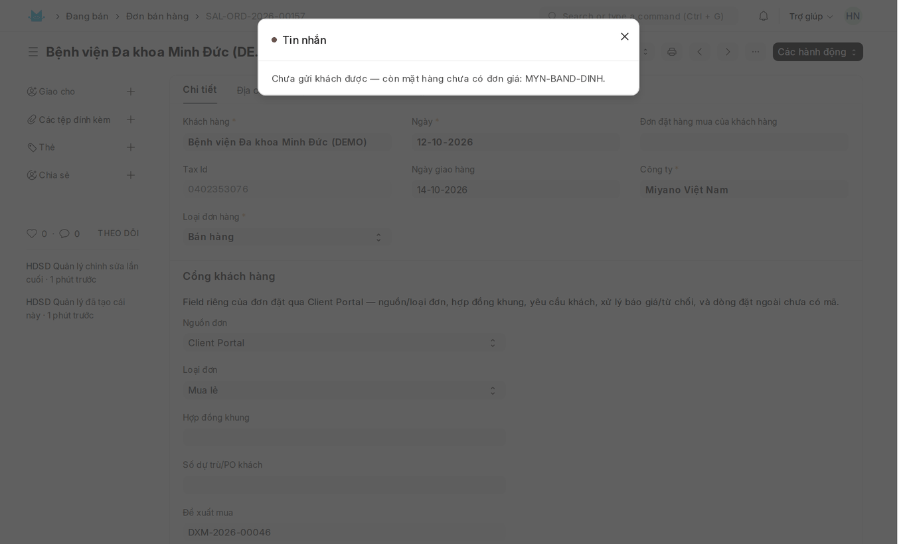

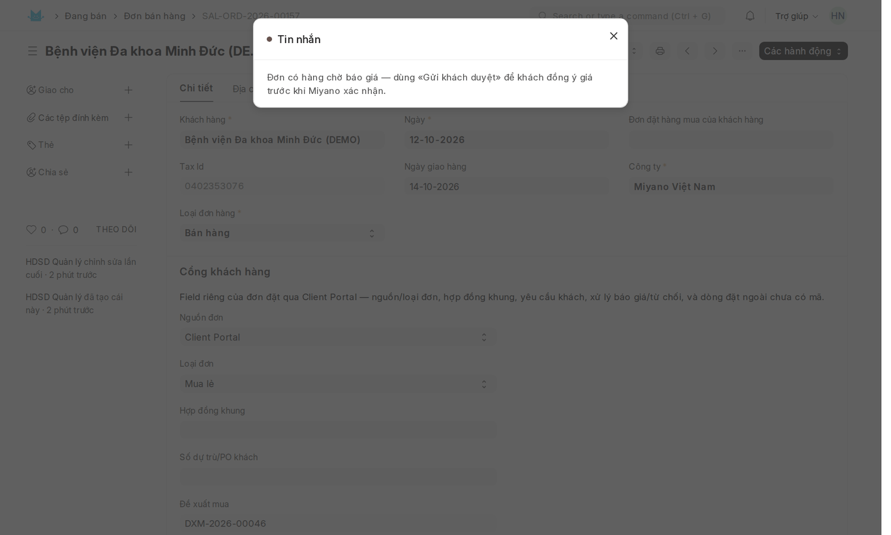

**Lỡ nhập sai giá sau khi khách đã đồng ý?** Sửa đơn giá cho đúng, rồi ở trạng
thái **Chờ Miyano xác nhận** bấm **Các hành động → Gửi khách duyệt** để khách
đồng ý lại giá mới. Không cần từ chối đơn.

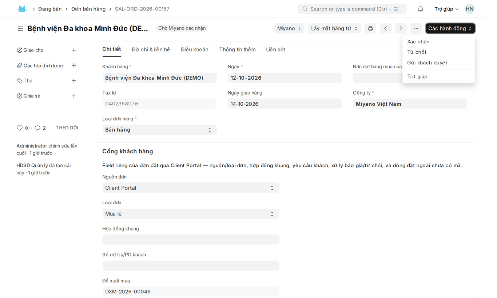

## B4. Khách đồng ý — giá được ghi vào Bảng giá

Khi khách bấm **Đồng ý**, hệ thống tự làm, nhân viên không phải thao tác:

- Ghi đơn giá của từng dòng báo giá vào **Bảng giá của khách đó** (Item Price).
- Đóng dấu **Giá khách đã đồng ý** lên dòng hàng.
- Ghi một bình luận vào phần **Hoạt động** của đơn: bảng giá nào, ai đồng ý,
  mặt hàng nào, giá cũ → giá mới.

Sau đó đơn ở **Chờ Miyano xác nhận**; bấm **Xác nhận** như đơn thường.

![Hình 19 – Phần Hoạt động của đơn: "[Portal] Ghi giá khách đã đồng ý vào … MYN-BAND-DINH: chưa có → 12.000"](hdsd-img/gia-bang-gia/18-desk-ghi-gia.png)

## B5. Bảng giá của khách — nhân viên cần biết

- **Mỗi khách một Bảng giá riêng.** Khách chưa có Bảng giá, hoặc đang dùng chung
  một bảng với khách khác, sẽ được hệ thống tạo bảng riêng tên
  "Bảng giá <tên khách>" khi cần ghi giá. Giá của khách này không lộ sang khách
  khác.
- **Muốn khách thấy giá và đặt ngay:** thêm Item Price (loại Bán) cho mặt hàng
  vào Bảng giá của khách đó. Muốn ngừng: xoá hoặc đặt ngày hết hiệu lực.
- **Hợp đồng nguyên tắc:** khi ghi sổ hợp đồng, đơn giá trong hợp đồng vẫn được
  chép vào Bảng giá của khách. Cổng không còn hiện hạn mức và không chặn theo
  hợp đồng.
- **Giảm giá cho khách:** sửa trong Bảng giá của khách. Đơn từ cổng **bỏ qua
  Pricing Rule** của ERPNext, nên khuyến mãi cấu hình bằng Pricing Rule không áp
  cho đơn đặt từ cổng.
- **Giá có ngày hiệu lực tương lai:** một dòng giá đã lên lịch cho tương lai sẽ
  được dùng khi tới ngày, kể cả khi trước đó khách vừa đồng ý một giá khác.

---

# C — THỜI GIAN GIAO HÀNG

## C1. Nhân viên Miyano nhập ở đâu

| Thông tin | Nhập ở đâu | Khi nào khách thấy |
|---|---|---|
| **Ngày dự kiến giao** của từng mặt hàng | Đơn bán hàng → bảng Các mặt hàng → cột **Ngày giao hàng** của từng dòng | Sau khi đơn được **Xác nhận** |
| **Thời gian giao hàng** thật của một đợt | Phiếu giao hàng (Delivery Note) → trường **Thời gian giao hàng** (ngày và giờ) | Sau khi phiếu giao được ghi sổ |

Trường **Thời gian giao hàng** là thời điểm hàng tới khách, khác với ngày ghi sổ
của phiếu. Phiếu lập chiều nay cho chuyến xe sáng mai thì nhập ngày giờ sáng
mai.

- **Để trống:** lúc ghi sổ (Submit) hệ thống tự điền ngày giờ ghi sổ.
- **Đã nhập tay:** hệ thống giữ nguyên, không ghi đè.

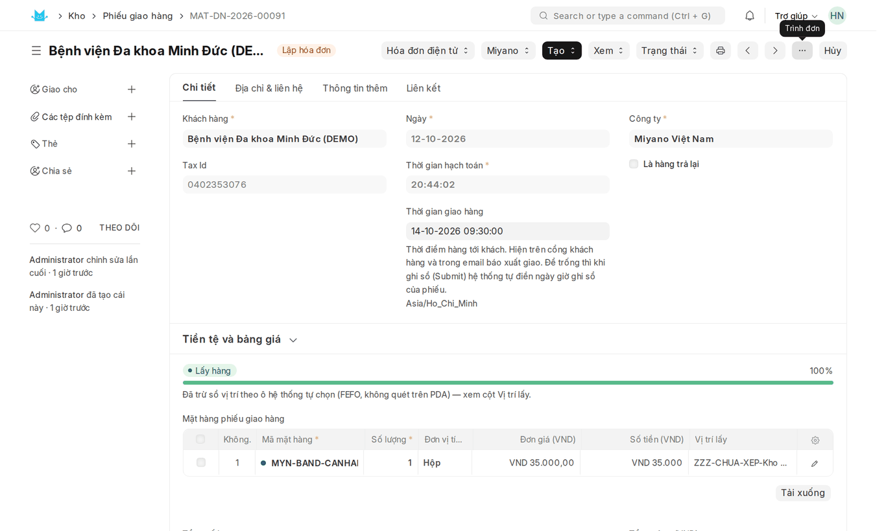

## C2. Khách thấy gì trên cổng

Mở chi tiết đơn:

- Bảng mặt hàng có cột **DỰ KIẾN GIAO**: ngày dự kiến của dòng chưa giao; dòng
  đã giao đủ hiện **Đã giao**.
- Khối **Giao hàng** liệt kê từng đợt kèm ngày giờ giao thật và tỉ lệ, ví dụ
  "Đợt 1 – 14/10/2026 09:30 (50%)".

Email báo xuất giao gửi khách cũng ghi thời gian giao này.

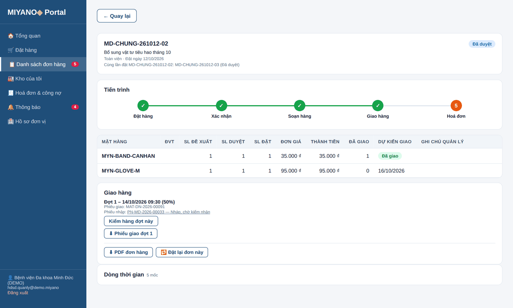

---

# D — Bảng tra

## D1. Nhãn giá

| Nơi | Giá trị | Nghĩa |
|---|---|---|
| Cột GIÁ trên cổng | Bảng giá … ₫ | Có giá trong Bảng giá của khách |
| Cột GIÁ trên cổng | Chờ báo giá | Chưa có giá, đi đường báo giá |
| Loại đơn (Desk) | Theo bảng giá | Đơn chỉ gồm hàng có giá |
| Loại đơn (Desk) | Mua lẻ | Đơn cần báo giá |
| Nguồn giá của dòng (Desk) | Bảng giá | Đơn giá lấy từ Bảng giá |
| Nguồn giá của dòng (Desk) | Báo giá | Miyano điền; ghi vào Bảng giá khi khách đồng ý |

## D2. Trạng thái đơn báo giá

| Trạng thái trên Desk | Khách thấy | Ai làm bước tiếp |
|---|---|---|
| Chờ xác nhận | Đã duyệt · Chờ xác nhận | Miyano điền giá, **Gửi khách duyệt** |
| Chờ khách đồng ý | Chờ quý vị đồng ý | Khách: Đồng ý / Không đồng ý / Gửi lại để báo giá |
| Chờ Miyano xác nhận | Đã duyệt | Miyano **Xác nhận** (hoặc **Gửi khách duyệt** lại nếu phải sửa giá) |
| Đã xác nhận | Đang xử lý | Miyano lập phiếu giao |

---

# E — Sự cố thường gặp

| Hiện tượng | Nguyên nhân và cách xử lý |
|---|---|
| Khách không thấy giá một mặt hàng dù đã ký hợp đồng | Mặt hàng chưa có Item Price còn hiệu lực trong Bảng giá của khách. Kiểm tra Bảng giá; thêm giá hoặc ghi sổ lại hợp đồng |
| Khách gửi một lần mà ra hai phiếu | Đúng thiết kế: giỏ có cả hàng có giá và hàng chờ báo giá |
| Quản lý duyệt một phiếu, phiếu kia vẫn "Chờ duyệt" | Đã bấm **Duyệt** thay vì **Duyệt cả hai**. Mở phiếu kia và duyệt tiếp |
| Đơn hàng ra giá khác lúc khoa gửi phiếu | Bảng giá đổi trong lúc chờ duyệt; đơn lấy giá tại lúc duyệt. Quản lý đã được cảnh báo trên màn duyệt |
| Không bấm **Xác nhận** được, báo "khác giá khách đã đồng ý" | Đơn giá đã bị sửa sau khi khách đồng ý. Bấm **Gửi khách duyệt** để khách đồng ý lại |
| Cổng hiện giờ giao trùng giờ ghi sổ phiếu | Trường **Thời gian giao hàng** để trống lúc ghi sổ. Lần sau nhập trước khi ghi sổ |

---

# F — Hệ thống cố ý KHÔNG làm

- **Không kiểm soát hạn mức hợp đồng trên cổng.** Số lượng đã đặt theo hợp đồng
  không còn được cộng dồn từ đơn cổng.
- **Không áp Pricing Rule** cho đơn đặt từ cổng. Một nguồn giá duy nhất: Bảng
  giá của khách.
- **Không ghi giá vào Bảng giá khi Miyano mới báo giá.** Chỉ ghi khi khách bấm
  Đồng ý.
- **Không chặn sửa số lượng sau khi khách đồng ý.** Chốt 3 chỉ canh đơn giá.
- **Không gộp lại hai phiếu đã tách.** Mỗi phiếu thành một đơn hàng riêng, giao
  và xuất hoá đơn riêng.
- **Không tách lần hai.** Phiếu đã gửi rồi thu hồi về sửa thì gửi lại vẫn là
  phiếu đó.
