# Hướng dẫn sử dụng — Yêu cầu báo giá

Cổng khách hàng Miyano · Cập nhật **13/10/2026**

Tài liệu này mô tả chức năng **Yêu cầu báo giá**: hàng chưa có giá hoặc chưa có
mã không còn thành đơn hàng ngay, mà thành một yêu cầu báo giá riêng. Miyano báo
giá, bệnh viện đồng ý thì mới sinh đơn hàng.

| Phần | Dành cho | Nội dung |
|---|---|---|
| **A** | Bệnh viện (cổng khách hàng) | Gửi yêu cầu, xem báo giá, Đồng ý / Từ chối / Sửa số lượng |
| **B** | Nhân viên Miyano (Desk) | Hàng việc báo giá, khớp mã, điền giá, gửi khách, từ chối, mở lại |
| **C** | Cả hai | Bảng tra trạng thái và quyền |
| **D** | Cả hai | Sự cố thường gặp |
| **E** | Cả hai | Những việc hệ thống cố ý không làm |

**Địa chỉ môi trường thử nghiệm**

- Cổng khách hàng: <http://192.168.61.129:8003/portal>
- Desk nhân viên: <http://192.168.61.129:8003/app>

> Tài liệu này **thay** các đoạn nói về "đơn Mua lẻ chờ báo giá" trong tài liệu
> "Giá theo Bảng giá của khách & Thời gian giao hàng" (12/10/2026). Chỗ nào hai
> tài liệu nói khác nhau thì theo tài liệu này. Ảnh minh hoạ chụp trên dữ liệu
> thử của khách "Bệnh viện Đa khoa Minh Đức (DEMO)".

---

## Điều gì đã đổi — đọc phần này trước

| Trước đây | Bây giờ |
|---|---|
| Hàng chưa có giá thành một **đơn hàng** "Mua lẻ" ngay khi gửi, giá 0 ₫ | Thành một **yêu cầu báo giá**. Chưa có đơn hàng nào cho tới khi bệnh viện đồng ý |
| Đơn chờ báo giá nằm lẫn trong danh sách đơn hàng | Có tab riêng **Yêu cầu báo giá** cạnh tab **Đơn hàng** |
| Báo giá bị từ chối hay hết hạn vẫn nằm lại như một đơn nháp | Yêu cầu báo giá đóng lại ở nhóm **Đã đóng**; danh sách đơn hàng chỉ còn đơn thật |
| Khách sửa số lượng thì Miyano phải gõ lại toàn bộ giá | Giá Miyano đã điền **được giữ lại** làm gợi ý; nhân viên chỉ xem lại rồi gửi |
| Bộ phận báo giá không có hàng việc riêng | Desk có lối tắt **Yêu cầu báo giá** kèm số việc đang chờ |
| Báo giá hết hạn là hết | Quản lý kinh doanh của Miyano **Mở lại** được báo giá hết hạn |

```
BỆNH VIỆN (cổng)                               MIYANO (Desk)
────────────────                               ─────────────
Giỏ có hàng CHƯA CÓ GIÁ hoặc hàng GÕ TAY
   │
   ├─ phần có giá ─────► đơn hàng đặt ngay ───► Xác nhận ──► Giao hàng
   │
   └─ phần còn lại ────► YÊU CẦU BÁO GIÁ ─────► khớp mã, điền đơn giá
                         "Miyano đang báo giá"   bấm "Gửi khách duyệt"
        ◄──────────── báo giá ─────────────────────┘
        "Chờ anh/chị đồng ý"
        │
        ├─ Đồng ý ───────► sinh ĐƠN HÀNG ──────► Xác nhận ──► Giao hàng
        │                  giá ghi vào Bảng giá
        ├─ Sửa số lượng ─► quay về Miyano xem lại giá
        └─ Từ chối ──────► đóng
```

---

# A — KHÁCH HÀNG (cổng)

## A1. Khi nào một lần đặt trở thành yêu cầu báo giá

Vào **🛒 Đặt hàng**. Ở cột **GIÁ**, mặt hàng có nhãn **Chờ báo giá** là mặt hàng
chưa có giá trong Bảng giá của đơn vị. Vẫn bấm **+ Giỏ** được như mọi mặt hàng
khác.

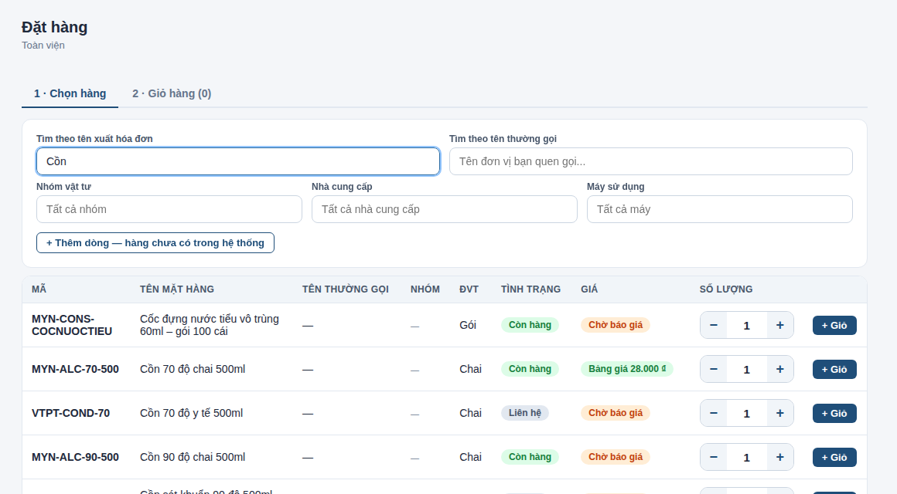

Hàng không tìm thấy trong danh mục thì bấm **+ Thêm dòng — hàng chưa có trong
hệ thống** và mô tả mặt hàng:

1. Điền **Tên hàng**, **ĐVT**, **Số lượng** (bắt buộc).
2. Bấm **+ Chọn ảnh** để gửi ảnh nhãn hộp. Không chụp được thì tích **Tôi không
   chụp được ảnh** và mô tả bằng lời.
3. Nên điền thêm **Model / mã catalogue**, **Hãng sản xuất**, **Nước sản xuất**,
   **Quy cách đóng gói** — Miyano dựa vào đó để tìm đúng hàng.

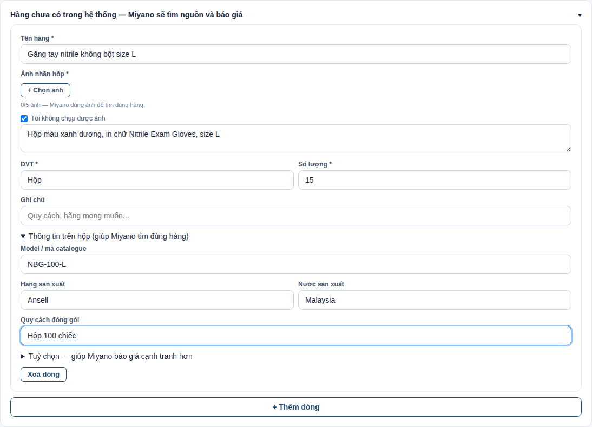

Một lần đặt trở thành yêu cầu báo giá khi giỏ có **ít nhất một** mặt hàng "Chờ
báo giá" hoặc một mặt hàng tự khai.

## A2. Giỏ hàng — đọc dòng báo trước khi gửi

Sang bước **2 · Giỏ hàng**. Cuối màn hình có một dòng nền xanh báo trước điều
sẽ xảy ra:

| Giỏ gồm | Dòng báo | Kết quả |
|---|---|---|
| Cả hàng có giá lẫn hàng chờ báo giá | "Lần đặt này sẽ tách làm hai: … mặt hàng có giá thành đơn đặt ngay theo bảng giá, … mặt hàng chờ báo giá thành một yêu cầu báo giá riêng." | **Một đơn hàng** đặt ngay và **một yêu cầu báo giá** |
| Chỉ có hàng chờ báo giá | "Giỏ có hàng chờ báo giá — sẽ gửi thành yêu cầu báo giá; Miyano báo giá, quý vị đồng ý rồi mới thành đơn hàng." | **Một yêu cầu báo giá** |
| Chỉ có hàng có giá | Không có dòng báo | Một đơn hàng như trước |

**Tạm tính (hàng có giá)** chỉ cộng các dòng đã có giá. Dòng chờ báo giá hiện
"—".

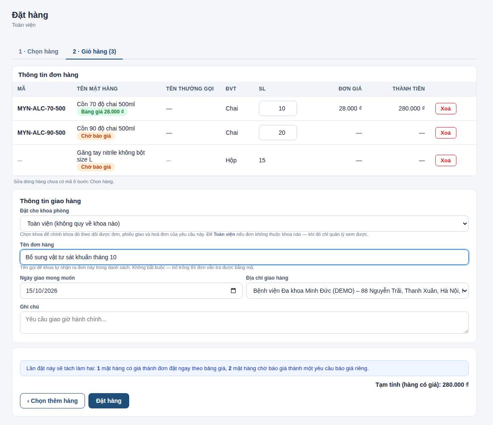

Nút cuối màn tuỳ vai của người đặt:

| Người đặt | Nút | Sau khi bấm |
|---|---|---|
| Quản lý | **Đặt hàng** | Giỏ trộn: thông báo "Đã tạo 1 đơn đặt ngay và 1 yêu cầu báo giá.", về Danh sách đơn hàng. Giỏ chỉ có hàng chờ báo giá: thông báo "Đã gửi yêu cầu báo giá cho Miyano.", mở luôn yêu cầu vừa tạo |
| Nhân viên khoa | **Gửi duyệt** | Thông báo "Đã gửi duyệt — mã phiếu …". Phiếu chờ quản lý của đơn vị duyệt; **chưa tới Miyano** (xem A9) |

## A3. Tab "Yêu cầu báo giá" và năm nhóm

Vào **📋 Danh sách đơn hàng**. Màn này có hai tab:

- **Đơn hàng** — đơn đã đặt.
- **Yêu cầu báo giá** — mọi yêu cầu báo giá. Con số đỏ trên tab là số báo giá
  đang chờ đơn vị trả lời.

Trong tab **Yêu cầu báo giá**, bấm một nhóm để lọc:

| Nhóm | Nghĩa là | Việc đang ở phía ai |
|---|---|---|
| **Nháp / chờ duyệt nội bộ** | Phiếu của khoa chưa gửi, đang chờ quản lý đơn vị duyệt, hoặc bị quản lý từ chối | Bệnh viện |
| **Miyano đang báo giá** | Yêu cầu đã tới Miyano, chưa có giá | Miyano |
| **Chờ anh/chị đồng ý** | Miyano đã gửi báo giá | Bệnh viện |
| **Đã đồng ý** | Đã đồng ý, đơn hàng đã sinh | — |
| **Đã đóng** | Bệnh viện từ chối, Miyano từ chối, hoặc báo giá hết hạn | — |

Cột **TÌNH TRẠNG** có hai dòng: nhãn màu là nhóm, dòng chữ nhỏ bên dưới là
trạng thái chi tiết. Cột **GIÁ TRỊ BÁO GIÁ** và **HIỆU LỰC ĐẾN** hiện "—" cho
tới khi Miyano gửi báo giá.

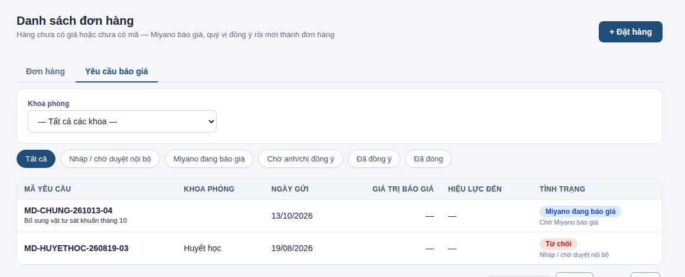

Bấm vào một dòng để mở. Khi Miyano chưa báo giá, màn chi tiết **không hiện đơn
giá**. Hàng tự khai nằm ở khối **Hàng quý vị mô tả — Miyano đang tìm mã**.

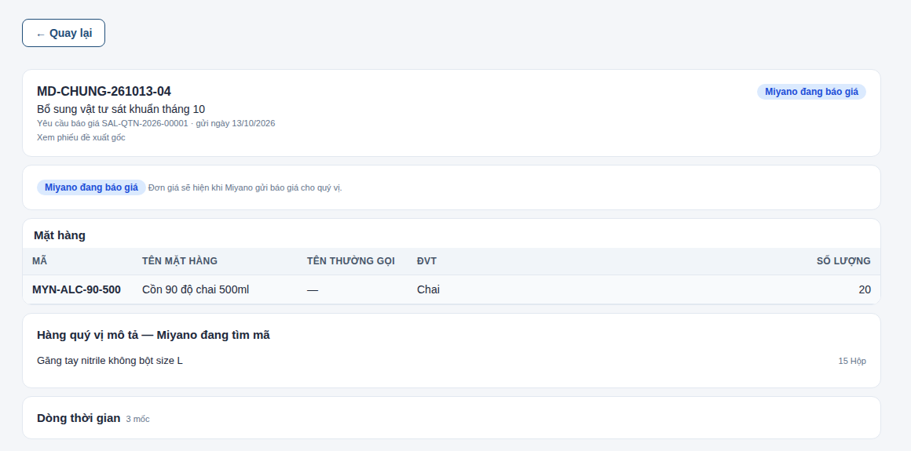

## A4. Nhận báo giá

Khi Miyano gửi báo giá, đơn vị biết qua ba chỗ:

- Màn **🔔 Thông báo** có dòng "Báo giá … đã sẵn sàng". Bấm vào để mở báo giá.
- Thẻ **Báo giá chờ đồng ý** trên màn **🏠 Tổng quan**. Bấm thẻ để tới thẳng
  nhóm "Chờ anh/chị đồng ý".
- Con số đỏ trên tab **Yêu cầu báo giá**.

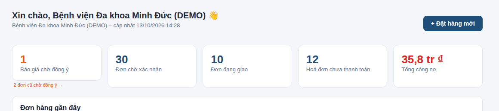

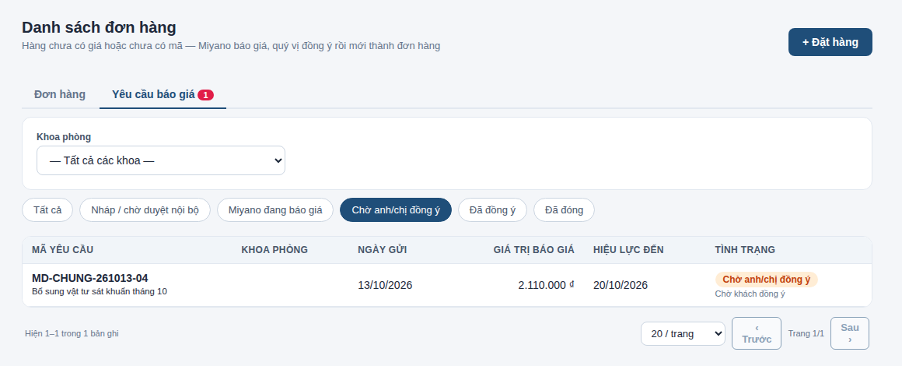

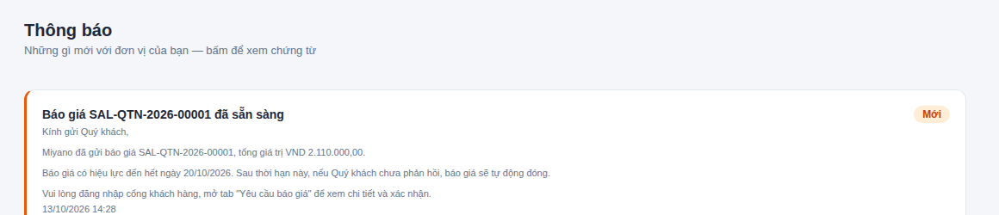

Mở báo giá sẽ thấy đơn giá, thành tiền, tổng cộng và ngày **hiệu lực đến**. Hàng
tự khai nay đã có mã và tên chính thức của Miyano.

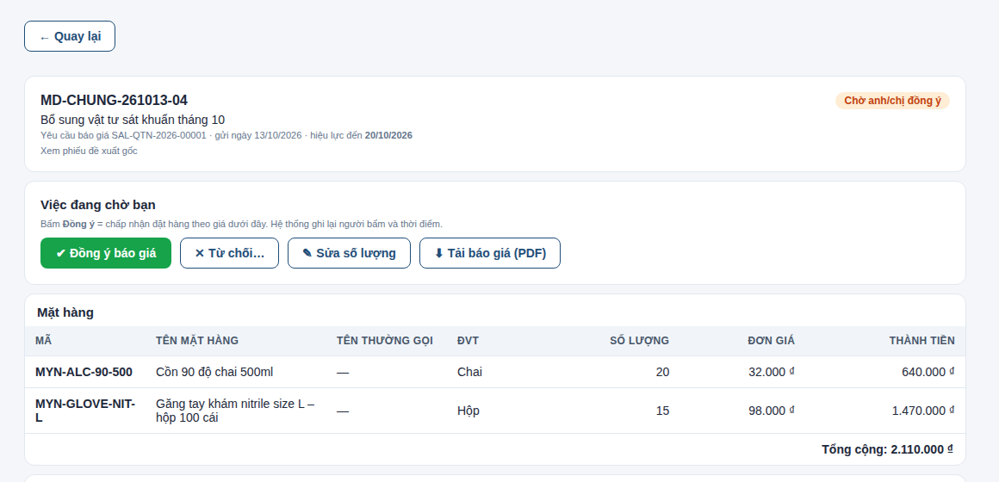

## A5. Tải báo giá (PDF)

Bấm **⬇ Tải báo giá (PDF)**. Báo giá mở ở thẻ mới của trình duyệt, in hoặc lưu
được. Bản PDF ghi rõ hàng tự khai đã được khớp với mã nào.

Nút này chỉ có từ lúc Miyano đã gửi báo giá, và vẫn còn sau khi báo giá đã đồng
ý, bị đơn vị từ chối hoặc hết hạn.

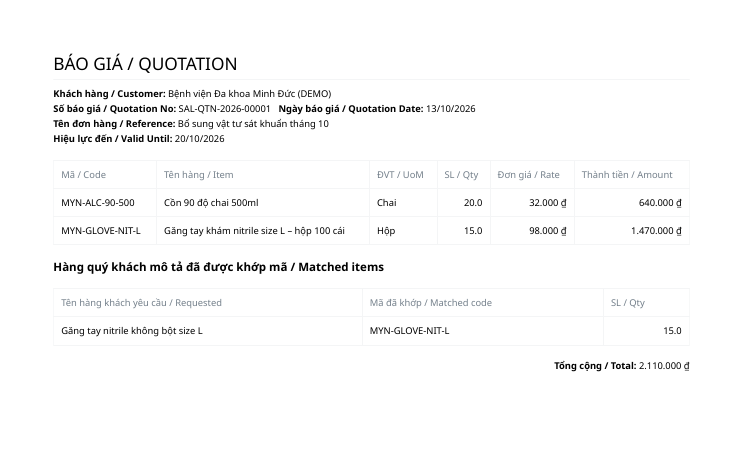

## A6. Trả lời báo giá

Khối **Việc đang chờ bạn** có các nút:

| Nút | Kết quả | Ai bấm được |
|---|---|---|
| **✔ Đồng ý báo giá** | Chấp nhận toàn bộ báo giá. Đơn hàng được tạo ngay | Quản lý, nhân viên của khoa có yêu cầu đó |
| **✕ Từ chối…** | Đóng yêu cầu báo giá | Quản lý, nhân viên của khoa có yêu cầu đó |
| **✎ Sửa số lượng** | Đổi số lượng rồi gửi lại cho Miyano | **Chỉ quản lý** |

> **Đồng ý có hiệu lực ngay**, không có hộp hỏi lại. Hệ thống ghi lại người bấm
> và thời điểm. Hãy xem kỹ giá và số lượng trước khi bấm.

### Đồng ý

Bấm **✔ Đồng ý báo giá**. Thông báo hiện: "Đã đồng ý — đơn hàng đã được tạo và
chuyển cho Miyano xác nhận." Yêu cầu chuyển sang **Đã đồng ý** và có dòng **Xem
đơn hàng … →**.

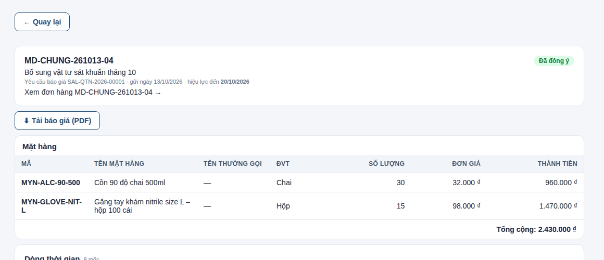

### Sửa số lượng (chỉ quản lý)

1. Bấm **✎ Sửa số lượng**. Cột số lượng thành ô nhập.
2. Gõ số lượng mới. Chỉ sửa số lượng của các dòng đang có; không thêm, không
   bỏ được dòng.
3. Bấm **Gửi lại để báo giá**. Muốn thôi thì bấm **✕ Huỷ sửa số lượng**.

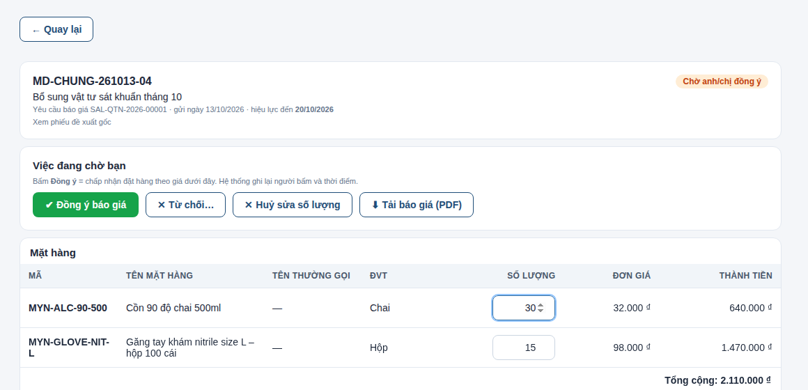

Số lượng phải lớn hơn 0. Gõ 0 thì hệ thống chặn và nói rõ mặt hàng nào:

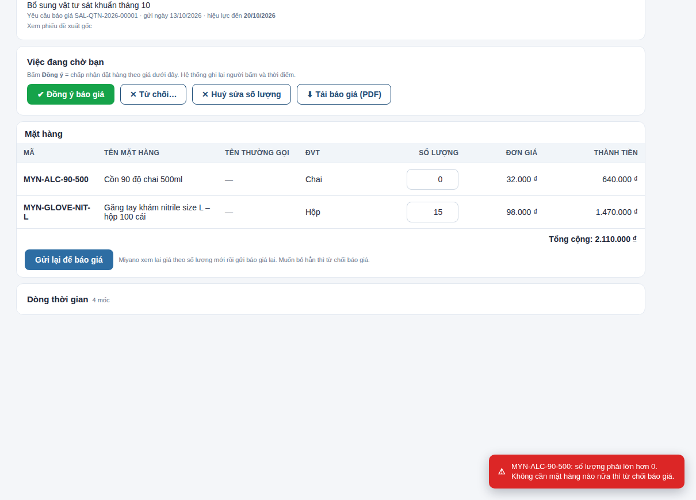

Sau khi gửi, thông báo hiện "Đã gửi lại — Miyano sẽ xem lại giá theo số lượng
mới." Yêu cầu quay về **Miyano đang báo giá** và **đơn giá ẩn đi** cho tới khi
Miyano gửi báo giá lại. Hạn hiệu lực cũ cũng bị xoá; lần gửi lại có hạn mới.

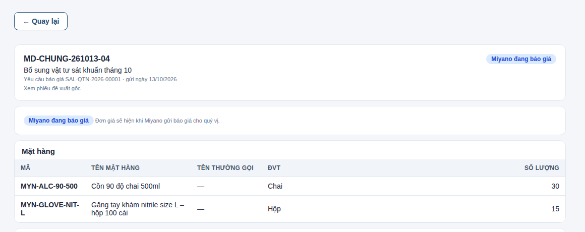

### Từ chối

Bấm **✕ Từ chối…**, ghi lý do nếu muốn (không bắt buộc), rồi bấm **Từ chối báo
giá**.

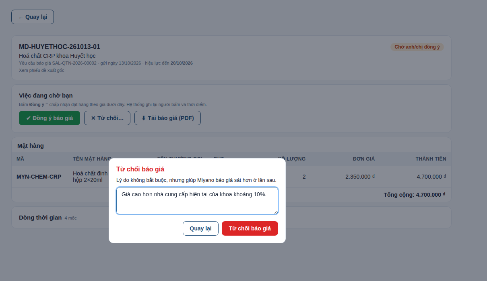

Yêu cầu chuyển sang nhóm **Đã đóng**, lý do hiện ngay dưới tiêu đề. Báo giá đã
từ chối **không mở lại được**; vẫn cần hàng thì gửi yêu cầu báo giá mới.

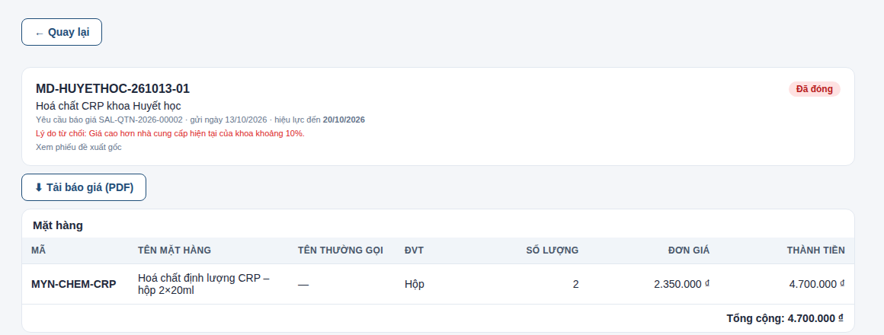

## A7. Sau khi đồng ý — đơn hàng ở đâu

- Đơn hàng xuất hiện ở tab **Đơn hàng**, **mang cùng mã** với yêu cầu báo giá,
  giai đoạn "Đã duyệt · Chờ xác nhận". Từ đây đơn đi như mọi đơn khác: Miyano
  xác nhận, giao hàng, xuất hoá đơn.
- Yêu cầu báo giá ở lại tab **Yêu cầu báo giá**, nhóm **Đã đồng ý**. Hai bên có
  đường dẫn qua lại: **Xem đơn hàng … →** và **Xem yêu cầu báo giá … →**.

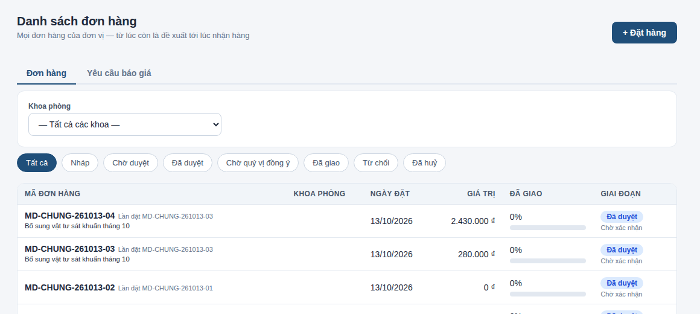

- Giá vừa đồng ý được ghi vào Bảng giá của đơn vị. Lần sau các mặt hàng đó hiện
  **Bảng giá … ₫** trên màn chọn hàng và đặt ngay được.

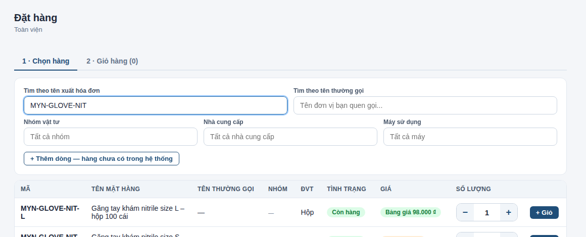

## A8. Hạn hiệu lực, và khi Miyano từ chối

**Hạn hiệu lực.** Mỗi báo giá có ngày **hiệu lực đến** (trên môi trường thử
nghiệm là 7 ngày kể từ ngày Miyano gửi). Quá ngày đó:

- Báo giá hiện dòng đỏ "Báo giá đã quá hạn hiệu lực. Gửi yêu cầu báo giá mới
  nếu vẫn cần hàng." và không còn nút Đồng ý, Từ chối, Sửa số lượng.
- Mỗi ngày hệ thống tự đóng các báo giá quá hạn; chúng chuyển sang nhóm **Đã
  đóng**, dòng chữ nhỏ ghi "Báo giá hết hạn". Màn Thông báo của cổng không có dòng
  riêng cho việc này.
- Nếu vẫn cần đúng báo giá đó, liên hệ Miyano: quản lý kinh doanh của Miyano có
  thể mở lại và gửi báo giá lần nữa.

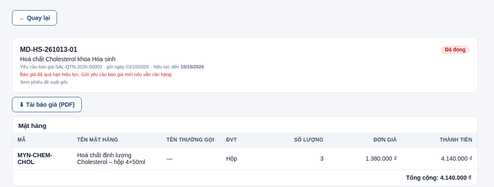

**Miyano từ chối.** Khi Miyano không báo giá được (ví dụ hàng ngừng sản xuất),
yêu cầu chuyển sang **Đã đóng** kèm lý do, và màn **🔔 Thông báo** có dòng "Yêu
cầu báo giá … đã bị từ chối".

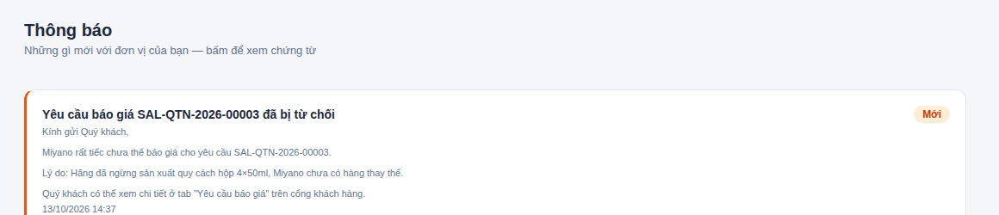

## A9. Quản lý và nhân viên khoa

| Việc | Quản lý | Nhân viên khoa |
|---|---|---|
| Thấy yêu cầu báo giá nào | Của mọi khoa và của toàn viện; lọc được theo **Khoa phòng** | Chỉ của khoa mình |
| Gửi yêu cầu báo giá | Bấm **Đặt hàng** — tới Miyano ngay | Bấm **Gửi duyệt** — quản lý duyệt xong mới tới Miyano |
| Đồng ý, Từ chối báo giá | Có | Có (báo giá của khoa mình) |
| Sửa số lượng trên báo giá | Có | **Không** — nhờ quản lý sửa |

Nhân viên khoa mở báo giá của khoa khác hoặc của toàn viện sẽ thấy "Không tìm
thấy chứng từ."

**Nhân viên khoa gửi yêu cầu.** Ở giỏ hàng, điền **Lý do yêu cầu** (bắt buộc)
rồi bấm **Gửi duyệt**.

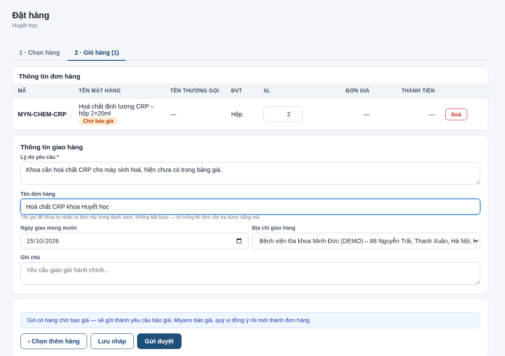

Phiếu nằm ở tab **Yêu cầu báo giá**, nhóm **Nháp / chờ duyệt nội bộ**, nhãn
"Chờ duyệt".

**Quản lý duyệt.** Bấm **📋 Danh sách đơn hàng** ở menu trái (con số đỏ là số
việc đang chờ), chọn nhóm **Chờ duyệt**. Phiếu yêu cầu báo giá của khoa nằm
chung hàng chờ với các phiếu đặt hàng khác.

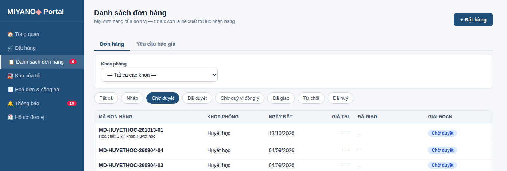

Mở phiếu, sửa **SL DUYỆT** nếu cần, rồi bấm **Duyệt** (hoặc **Từ chối** / **Huỷ
phiếu**).

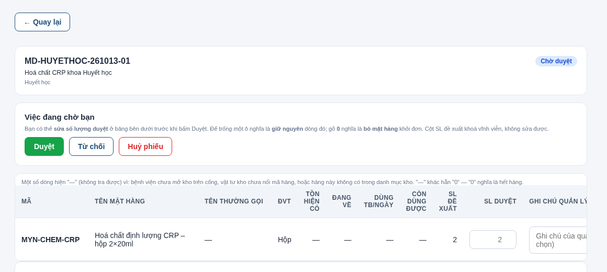

Thông báo hiện "Đã duyệt phiếu — yêu cầu báo giá đã gửi cho Miyano." Phiếu có
thêm dòng **Xem yêu cầu báo giá … →**.

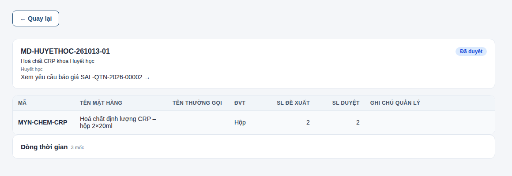

Khi Miyano báo giá, nhân viên khoa thấy báo giá của khoa mình với hai nút **Đồng
ý báo giá** và **Từ chối…**; không có nút Sửa số lượng.

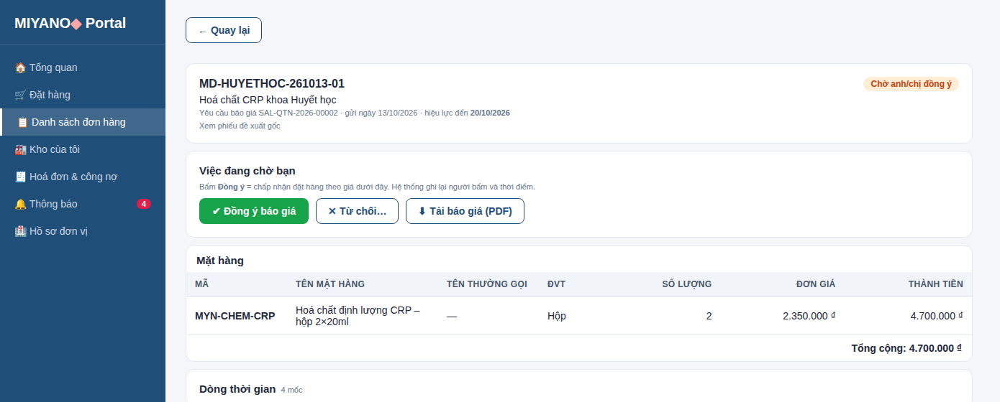

## A10. Trên điện thoại

Danh sách hiện thành từng thẻ; màn chi tiết giữ đủ các nút. Bảng mặt hàng rộng
hơn màn hình: **vuốt ngang trong bảng** để xem số lượng, đơn giá và thành tiền.

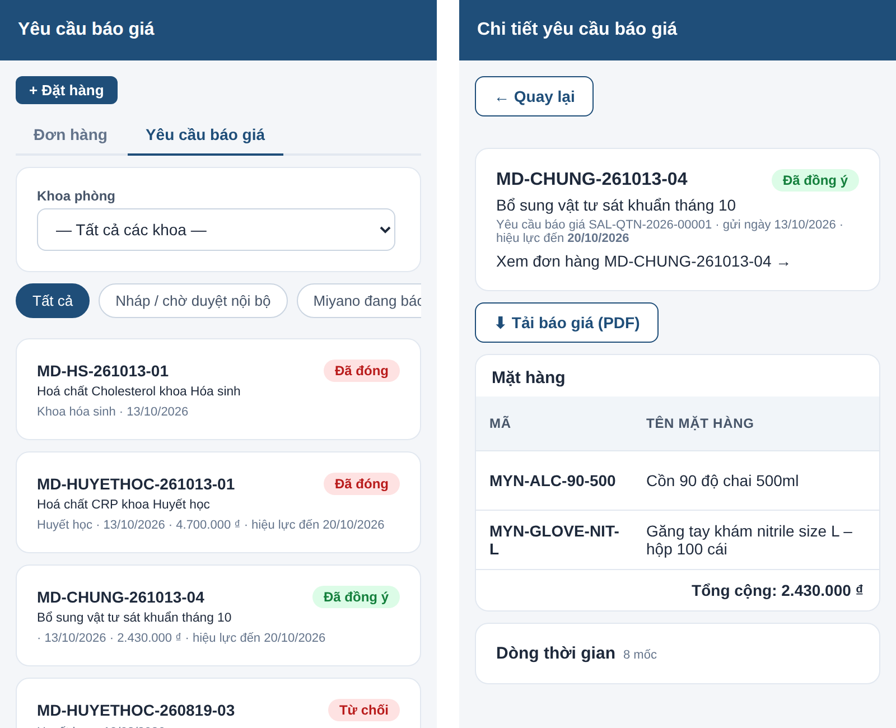

---

# B — NHÂN VIÊN MIYANO (Desk)

## B1. Hàng việc "Yêu cầu báo giá"

Mở Desk, vào không gian làm việc **Kho khách hàng**. Dưới mục **Việc từ cổng
khách hàng** có lối tắt **Yêu cầu báo giá**; con số bên cạnh là số yêu cầu đang
chờ Miyano báo giá.

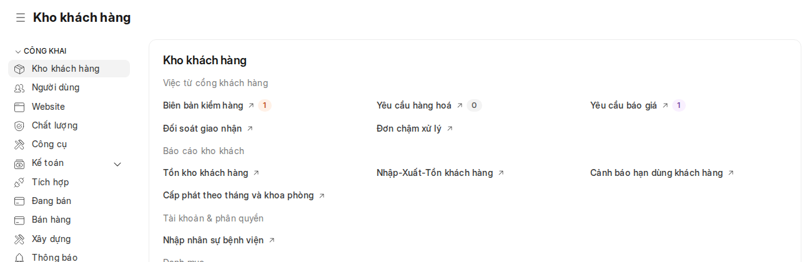

Bấm lối tắt để mở danh sách Báo giá đã lọc sẵn: nguồn là cổng khách hàng, trạng
thái **Chờ Miyano báo giá**.

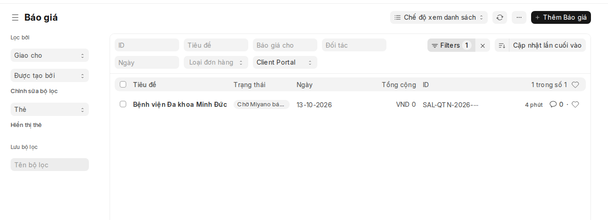

Mỗi khi có yêu cầu mới, nhân viên phụ trách khách còn nhận thông báo ở biểu
tượng chuông: "Portal - Yêu cầu báo giá mới: …".

## B2. Đọc yêu cầu

Mở một yêu cầu. Tab **Chi tiết** có hai bảng:

- **Các mặt hàng** — hàng có mã. Đơn giá bằng 0 là dòng chưa báo giá. Cột
  **Nguồn giá** ghi "Báo giá".
- **Hàng khách gõ tay (chưa có mã)** — hàng khách tự khai, chờ khớp mã.

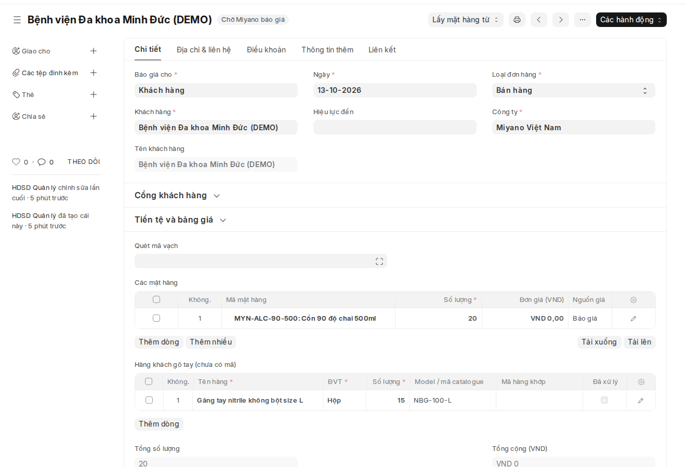

Ảnh nhãn hộp, mô tả nhận dạng, model, hãng, nước sản xuất, quy cách mà khách đã
khai nằm ở tab **Liên kết**, khối **Hàng chưa có mã — thông tin khách khai**.

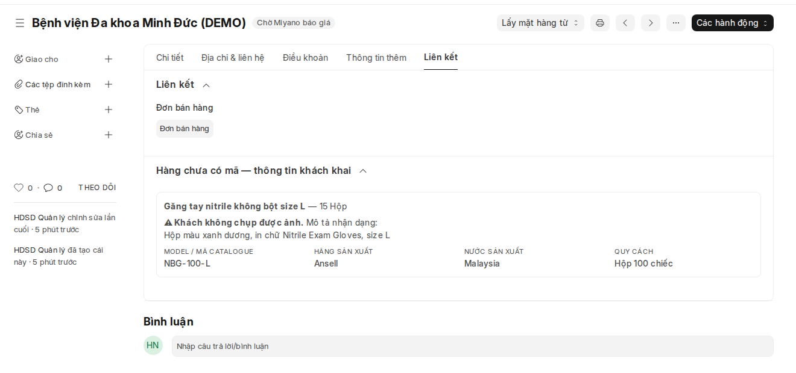

## B3. Khớp mã cho hàng khách gõ tay

1. Trong bảng **Hàng khách gõ tay (chưa có mã)**, bấm vào ô **Mã hàng khớp** của
   dòng cần khớp.
2. Gõ mã hoặc tên mặt hàng, chọn mặt hàng đúng trong danh sách gợi ý. Chưa có
   mã phù hợp thì tạo mặt hàng mới trước.
3. Bấm **Lưu** (Ctrl+S).

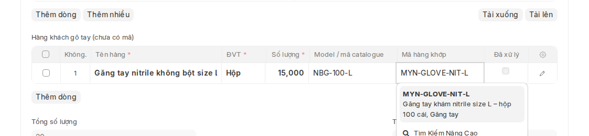

Sau khi lưu, hệ thống tự thêm một dòng vào bảng **Các mặt hàng** với đúng mã vừa
chọn và số lượng khách khai; dòng gõ tay được tích **Đã xử lý**.

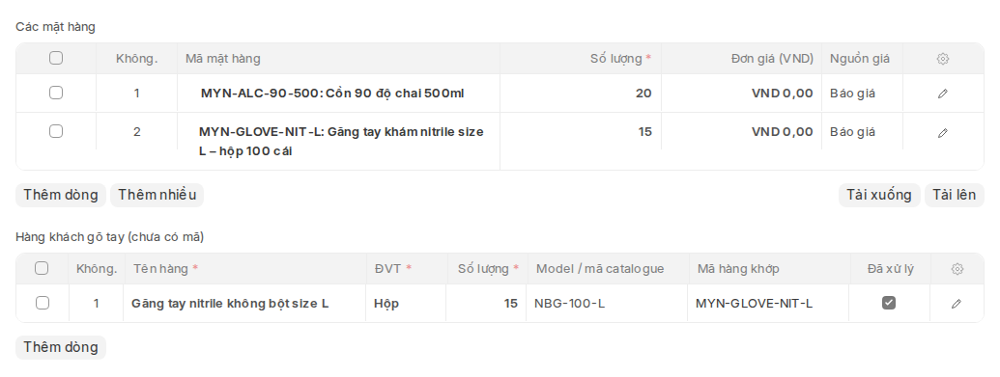

## B4. Điền giá và "Gửi khách duyệt"

1. Trong bảng **Các mặt hàng**, bấm vào ô **Đơn giá** của từng dòng và điền
   giá. Bấm **Lưu**.

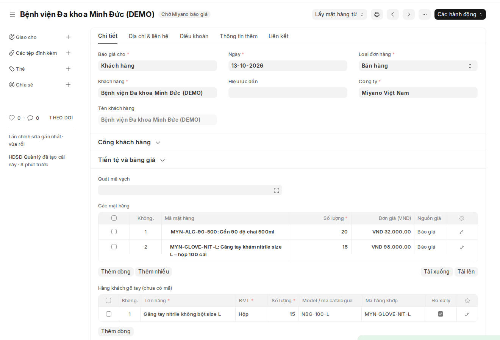

2. Bấm **Các hành động → Gửi khách duyệt**.

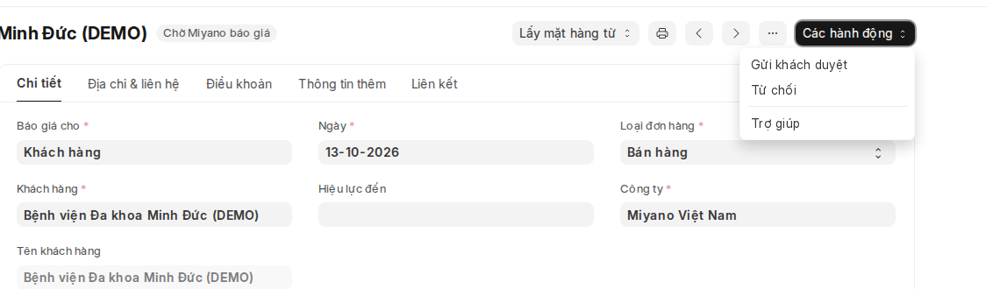

Yêu cầu sang **Chờ khách đồng ý**, ô **Hiệu lực đến** được điền tự động, và
bệnh viện nhận thông báo trên cổng. Ở trạng thái này biểu mẫu bị khoá, không
sửa tại chỗ được.

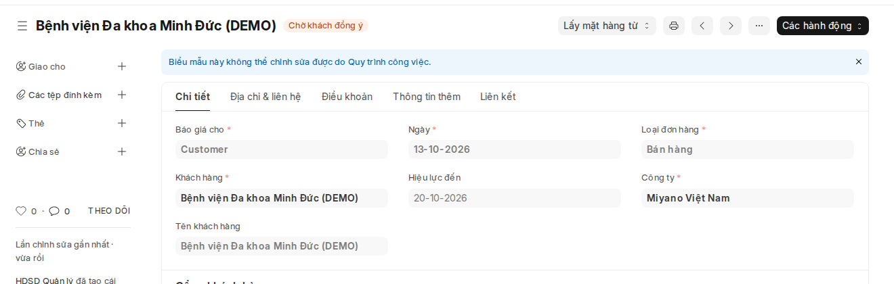

### Ba điều kiện bị chặn

Hệ thống không cho gửi và nói rõ vướng ở đâu khi còn một trong ba điều sau:

| # | Còn | Thông báo |
|---|---|---|
| 1 | Hàng khách gõ tay chưa khớp mã | "Chưa gửi khách được — còn hàng khách gõ tay chưa khớp mã: …" |
| 2 | Dòng giữ chỗ kỹ thuật (có khi yêu cầu chỉ gồm hàng gõ tay; tự mất khi đã khớp hết mã) | "Chưa gửi khách được — còn dòng giữ chỗ kỹ thuật …" |
| 3 | Mặt hàng chưa có đơn giá | "Chưa gửi khách được — còn mặt hàng chưa có đơn giá: …" |

Vướng nhiều điều cùng lúc thì một thông báo liệt kê hết.


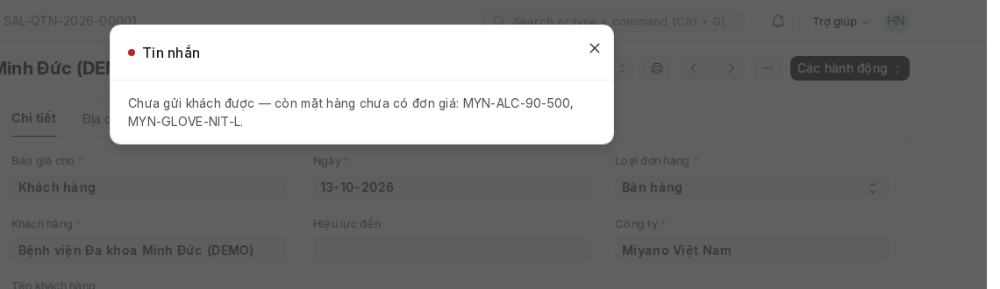

## B5. "Thu hồi để sửa"

Đã gửi mà phát hiện sai giá: bấm **Các hành động → Thu hồi để sửa**. Yêu cầu
quay về **Chờ Miyano báo giá**, hạn hiệu lực bị xoá, khách không còn thấy giá.
Sửa xong bấm **Gửi khách duyệt** lại; báo giá nhận hạn hiệu lực mới.

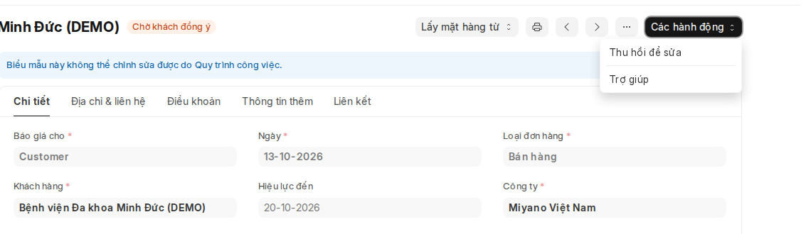

## B6. Khách sửa số lượng thì làm gì

Nhân viên phụ trách nhận thông báo ở biểu tượng chuông: "Portal - Khách sửa số
lượng báo giá: …".

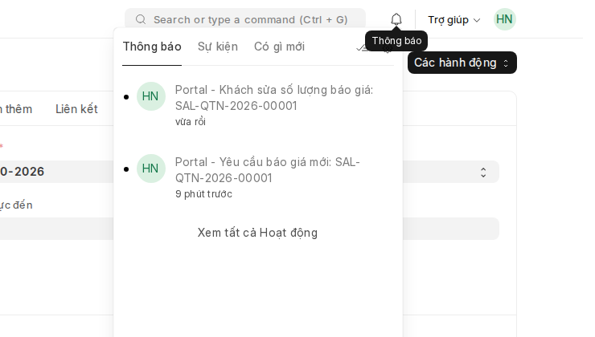

Mở yêu cầu:

- Trạng thái đã về **Chờ Miyano báo giá**; ô **Hiệu lực đến** trống.
- Số lượng là số mới của khách. **Đơn giá đã điền được giữ nguyên.**
- Phần **Hoạt động** cuối trang ghi dòng nào đổi, từ bao nhiêu thành bao nhiêu.

Xem lại giá theo số lượng mới, sửa nếu cần, rồi bấm **Các hành động → Gửi khách
duyệt**. Khách không thấy giá cho tới khi bước này xong.

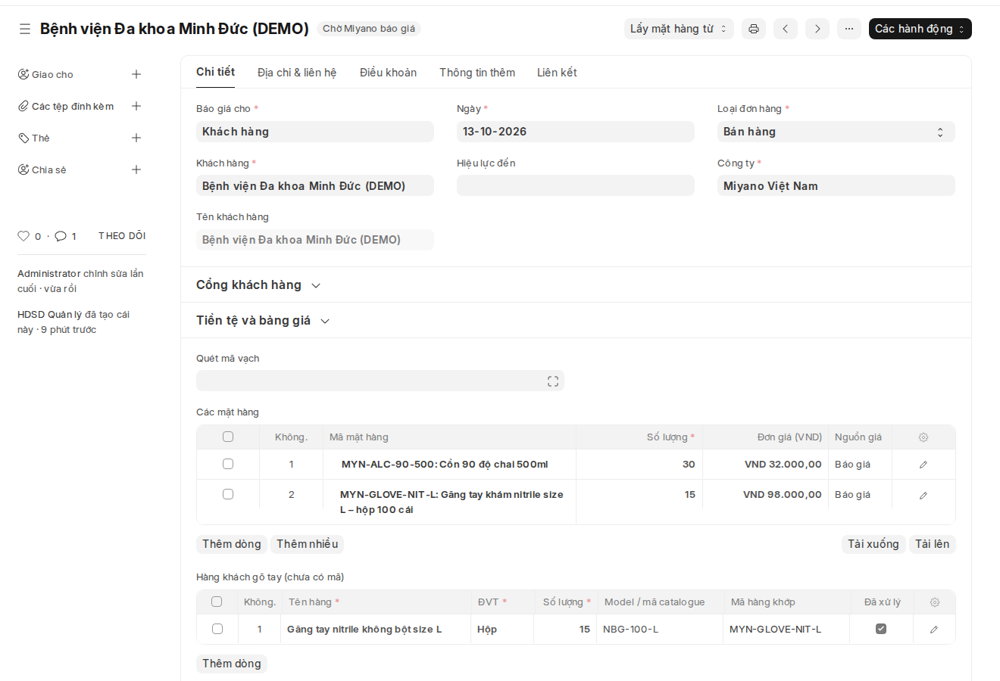

## B7. "Từ chối" — bắt buộc có lý do

Khi không báo giá được:

1. Mở khối **Cổng khách hàng** trên biểu mẫu (bấm vào tiêu đề khối để bung ra).
2. Điền **Lý do từ chối**, ít nhất 10 ký tự. Khách sẽ đọc đúng câu này.
3. Bấm **Lưu**, rồi **Các hành động → Từ chối**.

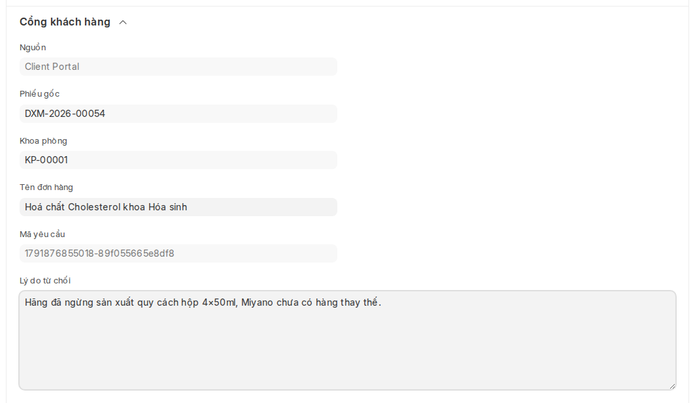

Chưa có lý do thì hệ thống chặn:

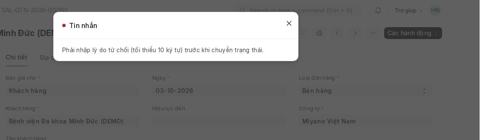

Yêu cầu sang **Miyano từ chối** và không còn hành động nào. Bệnh viện nhận
thông báo trên cổng kèm lý do.

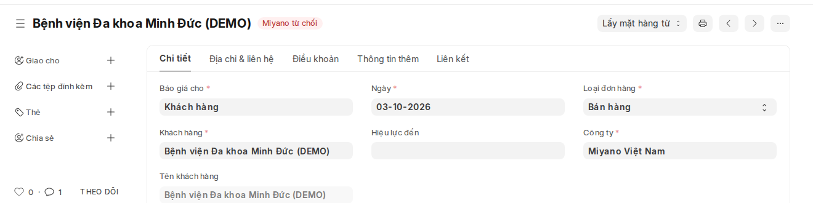

## B8. "Mở lại" báo giá hết hạn

Mỗi ngày hệ thống tự chuyển các báo giá quá ngày hiệu lực sang **Báo giá hết
hạn**. Người có vai **Sales Manager** mở lại được: **Các hành động → Mở lại**.

Báo giá quay về **Chờ Miyano báo giá**, hạn cũ bị xoá, đơn giá giữ nguyên. Xem
lại giá rồi **Gửi khách duyệt** để khách nhận báo giá với hạn mới.

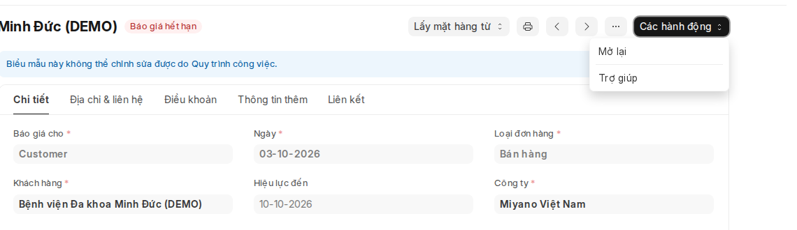

Báo giá ở **Khách từ chối** và **Miyano từ chối** không mở lại được.

## B9. Sau khi khách đồng ý

Khi khách bấm Đồng ý trên cổng, hệ thống tự làm, nhân viên không phải thao tác:

- Yêu cầu báo giá được ghi sổ, trạng thái **Khách đã đồng ý**.

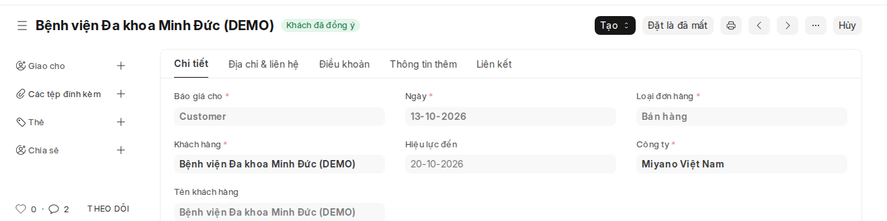

- Một **Đơn bán hàng** được tạo ở **Chờ Miyano xác nhận**, mang mã yêu cầu của
  khách. Trong khối **Cổng khách hàng**, **Loại đơn** là **Theo báo giá**. Đơn
  chỉ gồm hàng có mã, đơn giá đúng bằng giá khách đã đồng ý.

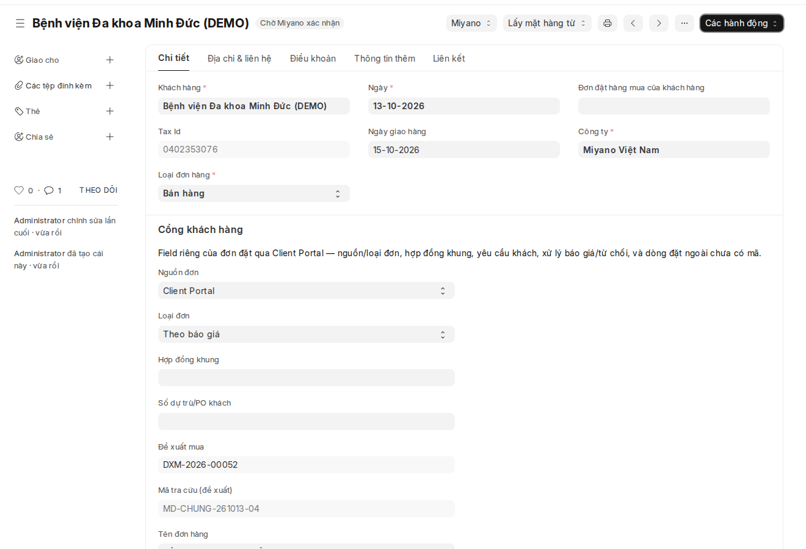

- Đơn giá từng dòng được **ghi vào Bảng giá của khách**. Phần **Hoạt động** của
  đơn ghi bảng giá nào, ai đồng ý, mặt hàng nào, giá cũ → giá mới.

![Hình 47 – Phần Hoạt động của đơn: "[Portal] Ghi giá khách đã đồng ý vào …"](hdsd-img/yeu-cau-bao-gia/47-desk-ghi-gia.png)

Việc còn lại của nhân viên: mở đơn, bấm **Các hành động → Xác nhận** như đơn
thường.

**Chốt "đơn giá khác giá khách đã đồng ý".** Nếu đơn giá trên đơn bị sửa khác
giá khách đã đồng ý, hệ thống không cho xác nhận và báo: "Đơn giá của … khác
giá khách đã đồng ý — gửi khách duyệt lại trước khi xác nhận." Cách xử lý: sửa
đơn giá về đúng giá đã đồng ý; hoặc nếu thật sự phải đổi giá thì bấm **Gửi
khách duyệt** trên đơn để khách đồng ý lại.

> Trên báo giá đã đồng ý, Desk vẫn hiện các nút có sẵn của phần mềm (**Tạo**,
> **Đặt là đã mất**, **Hủy**). Đơn hàng đã được tạo tự động — **không** dùng
> **Tạo** để lập thêm đơn thứ hai.

## B10. Báo giá nhân viên tự lập ngoài cổng

Báo giá nhân viên tự lập trên Desk (không bắt nguồn từ cổng) đi cùng bộ trạng
thái ở trên, với các khác biệt:

- Không hiện trên cổng của khách, kể cả khi cùng khách hàng.
- Không bị kiểm ba điều kiện ở B4 và không bị hệ thống tự đóng khi hết hạn.
- Ở **Chờ khách đồng ý** có thêm hành động **Ghi nhận khách đồng ý**: khách
  ngoài cổng không có tài khoản để tự bấm, nên nhân viên ghi nhận thay. Hành
  động này **không có** trên báo giá của cổng — ở đó chỉ chính khách bấm đồng ý
  được.

**Nhân bản một báo giá của cổng** (Duplicate) cho ra một **báo giá nội bộ**: bản
sao không mang nguồn cổng, phiếu gốc, khoa phòng, tên đơn hàng hay hàng khách gõ
tay, và không hiện trên cổng của khách.

---

# C — Bảng tra

## C1. Trạng thái

| Trạng thái trên Desk | Bệnh viện thấy (nhóm) | Ai đang giữ việc | Bệnh viện thấy giá? |
|---|---|---|---|
| *(chưa có báo giá — phiếu của khoa)* | Nháp / chờ duyệt nội bộ | Bệnh viện (khoa gửi, quản lý duyệt) | Không |
| Chờ Miyano báo giá | Miyano đang báo giá | Miyano | **Không**, kể cả giá đã điền trước đó |
| Chờ khách đồng ý | Chờ anh/chị đồng ý | Bệnh viện | Có, tải được PDF |
| Khách đã đồng ý | Đã đồng ý | Hết việc trên báo giá; đơn hàng chờ Miyano xác nhận | Có |
| Khách từ chối | Đã đóng | Kết thúc | Có |
| Miyano từ chối | Đã đóng | Kết thúc | Không |
| Báo giá hết hạn | Đã đóng | Kết thúc, trừ khi Sales Manager **Mở lại** | Có |

## C2. Ai được bấm gì

| Hành động | Ở đâu | Khi báo giá ở | Ai |
|---|---|---|---|
| Đặt hàng (gửi yêu cầu báo giá) | Cổng | — | Quản lý bệnh viện |
| Gửi duyệt | Cổng | — | Nhân viên khoa |
| Duyệt / Từ chối / Huỷ phiếu của khoa | Cổng | Chưa có báo giá | Quản lý bệnh viện |
| Đồng ý báo giá | Cổng | Chờ anh/chị đồng ý | Quản lý; nhân viên khoa (báo giá của khoa mình) |
| Từ chối… | Cổng | Chờ anh/chị đồng ý | Quản lý; nhân viên khoa (báo giá của khoa mình) |
| Sửa số lượng | Cổng | Chờ anh/chị đồng ý | Chỉ quản lý bệnh viện |
| Tải báo giá (PDF) | Cổng | Từ lúc Miyano đã gửi | Ai xem được báo giá đó |
| Gửi khách duyệt | Desk | Chờ Miyano báo giá | Nhân viên kinh doanh (Sales User) |
| Từ chối (có lý do) | Desk | Chờ Miyano báo giá | Nhân viên kinh doanh (Sales User) |
| Thu hồi để sửa | Desk | Chờ khách đồng ý | Nhân viên kinh doanh (Sales User) |
| Ghi nhận khách đồng ý | Desk | Chờ khách đồng ý, **chỉ báo giá ngoài cổng** | Nhân viên kinh doanh (Sales User) |
| Mở lại | Desk | Báo giá hết hạn | Quản lý kinh doanh (Sales Manager) |

---

# D — Sự cố thường gặp

| Hiện tượng | Nguyên nhân và cách xử lý |
|---|---|
| Gửi một lần mà ra một đơn hàng và một yêu cầu báo giá | Đúng thiết kế: giỏ có cả hàng có giá và hàng chờ báo giá. Dòng nền xanh cuối giỏ đã báo trước |
| Không thấy yêu cầu vừa gửi trong tab **Đơn hàng** | Yêu cầu báo giá nằm ở tab **Yêu cầu báo giá**. Nó chỉ sang tab Đơn hàng sau khi đồng ý |
| Mở yêu cầu mà không thấy giá | Yêu cầu đang ở "Miyano đang báo giá". Giá hiện khi Miyano gửi (hoặc gửi lại sau khi đơn vị sửa số lượng) |
| Bấm tải PDF, báo "Báo giá này chưa được gửi. Vui lòng đợi Miyano báo giá." | Như trên: chưa có báo giá để tải |
| "… số lượng phải lớn hơn 0. Không cần mặt hàng nào nữa thì từ chối báo giá." | Không bỏ riêng một dòng được. Giữ số lượng lớn hơn 0, hoặc từ chối cả báo giá rồi gửi yêu cầu mới |
| "Chưa sửa số lượng dòng nào." | Bấm **Gửi lại để báo giá** khi chưa đổi số nào. Đổi ít nhất một dòng, hoặc bấm **✕ Huỷ sửa số lượng** |
| Nhân viên khoa không thấy nút **Sửa số lượng** | Chỉ quản lý của đơn vị sửa được số lượng trên báo giá |
| Nhân viên khoa mở một báo giá, thấy "Không tìm thấy chứng từ." | Báo giá đó thuộc khoa khác hoặc toàn viện |
| Báo giá hiện "Báo giá đã quá hạn hiệu lực…", không còn nút | Đã quá ngày hiệu lực. Gửi yêu cầu mới, hoặc đề nghị Miyano mở lại |
| Mở đơn sinh từ báo giá trên cổng, bảng mặt hàng **thiếu** mặt hàng vốn là hàng tự khai | Hạn chế đã biết của bản này: màn chi tiết đơn chưa liệt kê hàng tự khai đã được khớp mã. Giá trị đơn trong danh sách vẫn đủ. Xem đầy đủ bằng **Xem yêu cầu báo giá … →** hoặc bản PDF báo giá |
| (Desk) Không thấy lối tắt **Yêu cầu báo giá** trong "Kho khách hàng" | Tài khoản cần vai kinh doanh. Nếu đã có vai mà vẫn không thấy, nhờ quản trị hệ thống làm mới bộ nhớ đệm rồi tải lại trang |
| (Desk) "Chưa gửi khách được — …" | Xem ba điều kiện ở B4: khớp mã hết hàng gõ tay, điền đủ đơn giá |
| (Desk) "Phải nhập lý do từ chối (tối thiểu 10 ký tự) trước khi chuyển trạng thái." | Điền **Lý do từ chối** trong khối **Cổng khách hàng**, bấm **Lưu**, rồi **Từ chối** lại |
| (Desk) Sau khi bấm **Gửi khách duyệt** hiện "Vui lòng cấu hình Tài khoản Email đi mặc định…" | Hệ thống chưa cấu hình email gửi đi. Trạng thái **vẫn chuyển** và khách **vẫn nhận thông báo trên cổng**; chỉ email không được gửi. Báo quản trị hệ thống cấu hình email |
| (Desk) Không sửa được biểu mẫu, báo "Biểu mẫu này không thể chỉnh sửa được do Quy trình công việc" | Báo giá đang ở phía khách. Bấm **Thu hồi để sửa** trước |
| (Desk) Không xác nhận được đơn, báo "… khác giá khách đã đồng ý …" | Đơn giá trên đơn khác giá khách đồng ý. Xem B9 |
| (Desk) Lịch sử ghi "Administrator" ở bước khách đồng ý / sửa số lượng | Bước của khách do hệ thống thực hiện thay. Người bấm thật được ghi trong dòng bình luận ngay cạnh ("… bởi …") |

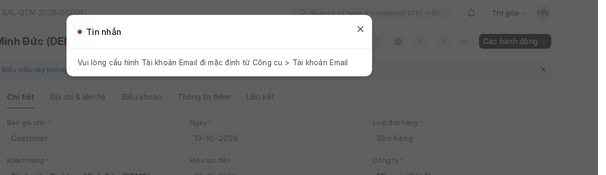

---

# E — Hệ thống cố ý KHÔNG làm

- **Không chọn từng dòng của báo giá.** Bệnh viện đồng ý hoặc từ chối cả báo
  giá. Không cần một mặt hàng thì từ chối và gửi yêu cầu mới.
- **Không thêm, không bỏ dòng khi sửa số lượng.** Chỉ đổi số lượng các dòng
  đang có, và phải lớn hơn 0.
- **Báo giá khách đã từ chối không mở lại.** Báo giá Miyano từ chối cũng vậy.
  Chỉ báo giá **hết hạn** mở lại được, và chỉ Sales Manager làm được.
- **Nhân viên khoa không sửa số lượng báo giá**, và chưa có đường "xin quản lý
  sửa" cho báo giá.
- **Khách không thấy giá khi báo giá đang ở phía Miyano**, kể cả giá đã từng
  thấy trước khi sửa số lượng: giá chưa được Miyano gửi lại thì chưa phải báo
  giá.
- **Không ghi giá vào Bảng giá khi Miyano mới báo giá.** Chỉ ghi khi khách bấm
  Đồng ý.
- **Đơn "Mua lẻ" cũ đang dở vẫn đi nốt luồng cũ.** Các đơn chờ báo giá lập
  trước bản này không được chuyển thành yêu cầu báo giá; chúng vẫn nằm ở tab
  Đơn hàng và trả lời trên chính đơn. Thẻ Tổng quan có dòng "… đơn cũ chờ đồng
  ý →" dẫn tới chúng.
- **Đơn sinh từ báo giá không mang số dự trù/PO của khách.** Ô **Số dự trù/PO
  khách** trên đơn để trống; nhân viên điền tay nếu cần.
- **Không lập nhiều phiên bản cho một báo giá.** Sửa giá làm trên chính báo giá
  đó qua **Thu hồi để sửa**.
- **Báo giá Miyano tự lập trên Desk không hiện lên cổng.** Cổng chỉ hiện báo
  giá bắt nguồn từ yêu cầu của chính bệnh viện.
